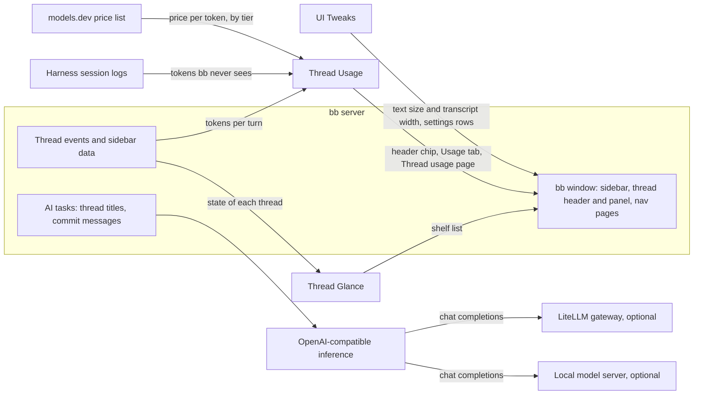

# bb plugins

Four plugins for [bb](https://getbb.app). **Thread Glance** replaces the sidebar's thread list with shelves, so you can snooze, park or settle a thread and have the list bring it back when its time comes, and keep Active in an order of your own. **Thread Usage** shows what a thread and every thread it spawned cost, in tokens and dollars estimated from models.dev's prices, each request priced on its own prompt size. **OpenAI-compatible inference** lets bb title threads and write commit messages through a LiteLLM gateway or a local model, where bb's built-in Codex service needs a Codex login. **UI Tweaks** adds appearance settings bb lacks: the size of the transcript and composer text, and the width of the transcript and composer columns, in thread views and on the New-thread screen. Each plugin installs on its own from this repository, and none depends on another: they share bb, not state.



The documentation starts at [docs/README.md](docs/README.md): tutorials for a first run of each plugin, how-to guides, reference and explanation.

| Plugin | What it does |
|---|---|
| [thread-glance](plugins/thread-glance) | Sidebar thread list of shelves: snooze, park or settle a thread, keep Active in your own order, and see each thread's state, branch and children at a glance. |
| [thread-usage](plugins/thread-usage) | Cost, tokens and time of a thread and all the threads it spawned, from bb's events and models.dev's prices. |
| [openai-inference](plugins/openai-inference) | Thread titles and commit messages from a LiteLLM gateway or a local OpenAI-compatible server, in place of bb's built-in Codex service. |
| [ui-tweaks](plugins/ui-tweaks) | Text size, for the transcript and the composer, and transcript width, as two rows drawn like bb's Appearance settings; both reach the New-thread screen too. |

## Install

Install one plugin by name (`thread-glance`, `thread-usage`, `openai-inference` or `ui-tweaks`):

```sh
bb plugin install git:https://github.com/gperezmz/bb-plugins.git@main --plugin thread-glance
```

[Install, update or remove a plugin](docs/how-to/install-plugins.md) covers pinning a release, installing a prebuilt package from npm, updating and removing; [develop a plugin](docs/how-to/develop-plugins.md) covers running one from a checkout.

## Contributing

[CONTRIBUTING.md](CONTRIBUTING.md) covers pull requests, commit messages and releasing a plugin.

## Licence

MIT, see [LICENSE](LICENSE). Each plugin lists the third-party code it bundles in its `THIRD_PARTY_NOTICES.md`.
