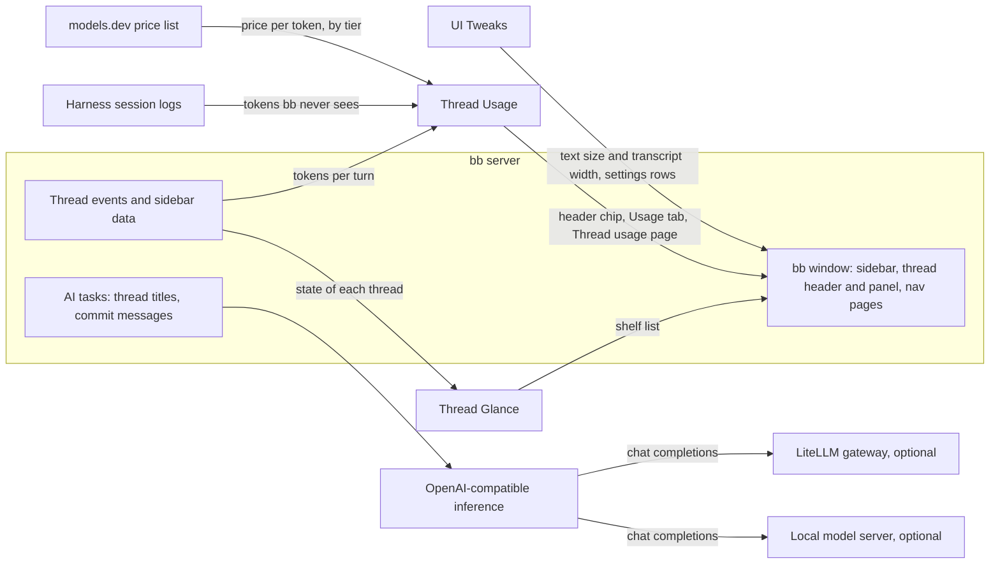

# bb plugins

Four plugins for [bb](https://getbb.app). **Thread Glance** replaces the sidebar's thread list with shelves, so you can snooze, park or settle a thread and have the list bring it back when its time comes, and keep Active in an order of your own. **Thread Usage** shows what a thread and every thread it spawned cost, in tokens and dollars estimated from models.dev's prices, each request priced on its own prompt size. **OpenAI-compatible inference** lets bb title threads and write commit messages through a LiteLLM gateway or a local model, where bb's built-in Codex service needs a Codex login. **UI Tweaks** adds appearance settings bb lacks: the size of the transcript and composer text, and the width of the transcript and composer columns, in thread views and on the New-thread screen. Each plugin installs on its own from this repository, and none depends on another: they share bb, not state.

The pages each plugin's behaviour rests on:

- [How the plugins fit into bb](explanation/how-the-plugins-fit-bb.md): where each part runs, what it stores, and the words the plugins share.
- [Why Thread Glance keeps threads on shelves](explanation/thread-glance-shelves.md): snooze, park, settle, automatic settle and reclaim.
- [How Thread Usage counts tokens and cost](explanation/thread-usage-counting.md).
- [How an AI task is sent](explanation/openai-inference-requests.md) by OpenAI-compatible inference, and how it asks for no reasoning.

## Map

**Tutorials** take you through a first run, start to finish.

- [Thread Glance: first run](tutorials/thread-glance-first-run.md)
- [Thread Usage: first run](tutorials/thread-usage-first-run.md)
- [OpenAI-compatible inference: first run](tutorials/openai-inference-first-run.md)

**How-to guides** do one job you already know you need.

- [Install, update or remove a plugin](how-to/install-plugins.md)
- [Develop a plugin from this repository](how-to/develop-plugins.md)
- [Switch the sidebar between Thread Glance and bb's list](how-to/thread-glance-switch-sidebar.md)
- [Title threads with a local model](how-to/openai-inference-local-server.md)

**Reference** lists every part, one entry each.

- [Thread Glance: the list, its shelves and rows](reference/thread-glance-list.md)
- [Thread Glance: actions, menus and reordering](reference/thread-glance-actions.md)
- [Thread Glance: settings and what it stores](reference/thread-glance-settings.md)
- [Thread Usage: settings](reference/thread-usage-settings.md)
- [Thread Usage: `bb thread-usage`](reference/thread-usage-cli.md)
- [Thread Usage: the `thread_usage` agent tool](reference/thread-usage-agent-tool.md)
- [Thread Usage: cost sources, prices and billing](reference/thread-usage-cost-sources.md)
- [OpenAI-compatible inference: Endpoints, the command and failures](reference/openai-inference-settings.md)
- [UI Tweaks: settings](reference/ui-tweaks-settings.md)

**Explanation** says why things work the way they do.

- [How the plugins fit into bb](explanation/how-the-plugins-fit-bb.md)
- [Why Thread Glance keeps threads on shelves](explanation/thread-glance-shelves.md)
- [How Thread Usage counts tokens and cost](explanation/thread-usage-counting.md)
- [How an AI task is sent](explanation/openai-inference-requests.md)
