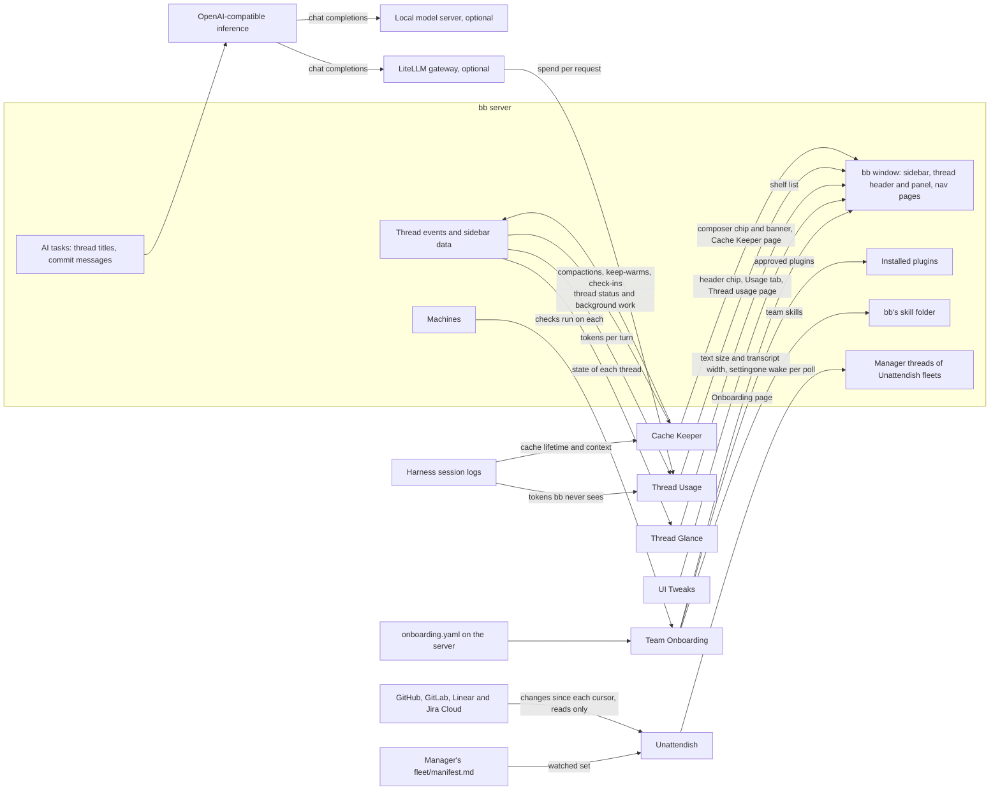

# bb plugins

Seven plugins for [bb](https://getbb.app). Three show something bb's own interface does not. **Thread Glance** replaces the sidebar's thread list with shelves, so you can snooze, park or settle a thread and have the list bring it back when its time comes, and keep Active in an order of your own. **Thread Usage** shows what a thread and every thread it spawned cost, in tokens and dollars, taking exact figures from a LiteLLM gateway when one sits in front of the models. **Team Onboarding** checks every machine against a setup your team writes down once, and fixes what it safely can. The fourth, **OpenAI-compatible inference**, lets bb title threads and write commit messages through a LiteLLM gateway or a local model, where bb's built-in Codex service needs a Codex login. The fifth, **Cache Keeper**, keeps idle Claude Code threads cheap to come back to, by compacting them just before their prompt cache goes cold and keeping threads that wait on background work warm, wherever you switch it on. The sixth, **UI Tweaks**, adds appearance settings bb lacks: the size of the transcript and composer text, and the width of the transcript and composer columns, in thread views and on the New-thread screen. The seventh, **Unattendish**, wakes the manager thread of an Unattendish fleet when the tracker or forge the fleet waits on changes, so an answer written on an issue, a review or a spec marked ready reaches the manager without the operator telling it; it reads GitHub, GitLab, Linear and Jira Cloud on an interval and sends one message per poll, and shows the operator what waits on them across fleets, on a Fleets page, a Fleet chip in each manager's header and a Fleet tab in its panel, where Answer…, Grant… and Build it send the manager the message. Each plugin installs on its own from this repository, and none depends on another: they share bb, not state, but for one read: Unattendish shows a fleet's cost from Thread Usage when that is installed, and leaves it out when it is not.

The pages each plugin's behaviour rests on:

- [How the plugins fit into bb](explanation/how-the-plugins-fit-bb.md): where each part runs, what it stores, and the words the plugins share.
- [Why Thread Glance keeps threads on shelves](explanation/thread-glance-shelves.md): snooze, park, settle, automatic settle and reclaim.
- [How Thread Usage counts tokens and cost](explanation/thread-usage-counting.md).
- [How Team Onboarding checks machines](explanation/team-onboarding-checks.md) without prompting, and why approvals happen only in the page.
- [How an AI task is sent](explanation/openai-inference-requests.md) by OpenAI-compatible inference, and how it asks for no reasoning.
- [When Cache Keeper acts](explanation/cache-keeper-timing.md): the deadline, the compaction line, waiting and the cost stop.
- [How Unattendish wakes a manager](explanation/unattendish-polling.md): the poll, the watched set, echoes, cursors that advance only on an accepted wake, credentials bound to a host, and what the dashboard adds.

## Map

**Tutorials** take you through a first run, start to finish.

- [Thread Glance: first run](tutorials/thread-glance-first-run.md)
- [Thread Usage: first run](tutorials/thread-usage-first-run.md)
- [Team Onboarding: first run and a first manifest](tutorials/team-onboarding-first-run.md)
- [OpenAI-compatible inference: first run](tutorials/openai-inference-first-run.md)
- [Cache Keeper: first run](tutorials/cache-keeper-first-run.md)
- [Unattendish: first run](tutorials/unattendish-first-run.md)

**How-to guides** do one job you already know you need.

- [Install, update or remove a plugin](how-to/install-plugins.md)
- [Develop a plugin from this repository](how-to/develop-plugins.md)
- [Switch the sidebar between Thread Glance and bb's list](how-to/thread-glance-switch-sidebar.md)
- [Connect a LiteLLM gateway for exact cost](how-to/thread-usage-connect-litellm.md)
- [Set price overrides and model aliases](how-to/thread-usage-set-prices.md)
- [Provision a manifest from a machine bootstrap](how-to/team-onboarding-provision-manifest.md)
- [Approve your team's commands](how-to/team-onboarding-approve-commands.md)
- [Title threads with a local model](how-to/openai-inference-local-server.md)
- [Compact a thread when it goes idle](how-to/cache-keeper-compact-a-thread.md)
- [Set the credentials for a fleet](how-to/unattendish-set-credentials.md)
- [Answer, grant or build from the dashboard](how-to/unattendish-answer-from-the-dashboard.md)

**Reference** lists every part, one entry each.

- [Thread Glance: the list, its shelves and rows](reference/thread-glance-list.md)
- [Thread Glance: actions, menus and reordering](reference/thread-glance-actions.md)
- [Thread Glance: settings and what it stores](reference/thread-glance-settings.md)
- [Thread Usage: settings](reference/thread-usage-settings.md)
- [Thread Usage: `bb thread-usage`](reference/thread-usage-cli.md)
- [Thread Usage: the `thread_usage` agent tool](reference/thread-usage-agent-tool.md)
- [Thread Usage: cost sources, prices, attribution and billing](reference/thread-usage-cost-sources.md)
- [Team Onboarding: settings](reference/team-onboarding-settings.md)
- [Team Onboarding: `bb team-onboarding`](reference/team-onboarding-cli.md)
- [Team Onboarding: items, statuses and safe fixes](reference/team-onboarding-items.md)
- [Team Onboarding: manifest](reference/team-onboarding-manifest.md)
- [OpenAI-compatible inference: endpoints, settings and failures](reference/openai-inference-settings.md)
- [Cache Keeper: settings, surfaces and messages](reference/cache-keeper-settings.md)
- [Cache Keeper: `bb cache-keeper` and the agent tool](reference/cache-keeper-cli.md)
- [UI Tweaks: settings](reference/ui-tweaks-settings.md)
- [Unattendish: `bb unattendish fleet` and the wake](reference/unattendish-cli.md)
- [Unattendish: settings and what it stores](reference/unattendish-settings.md)
- [Unattendish: the Fleets page, the Fleet chip and the Fleet tab](reference/unattendish-dashboard.md)
- [Unattendish: the Fleet contract, version 1](reference/unattendish-fleet-contract.md)

**Explanation** says why things work the way they do.

- [How the plugins fit into bb](explanation/how-the-plugins-fit-bb.md)
- [Why Thread Glance keeps threads on shelves](explanation/thread-glance-shelves.md)
- [How Thread Usage counts tokens and cost](explanation/thread-usage-counting.md)
- [How Team Onboarding checks machines](explanation/team-onboarding-checks.md)
- [How an AI task is sent](explanation/openai-inference-requests.md)
- [When Cache Keeper acts](explanation/cache-keeper-timing.md)
- [How Unattendish wakes a manager](explanation/unattendish-polling.md)
