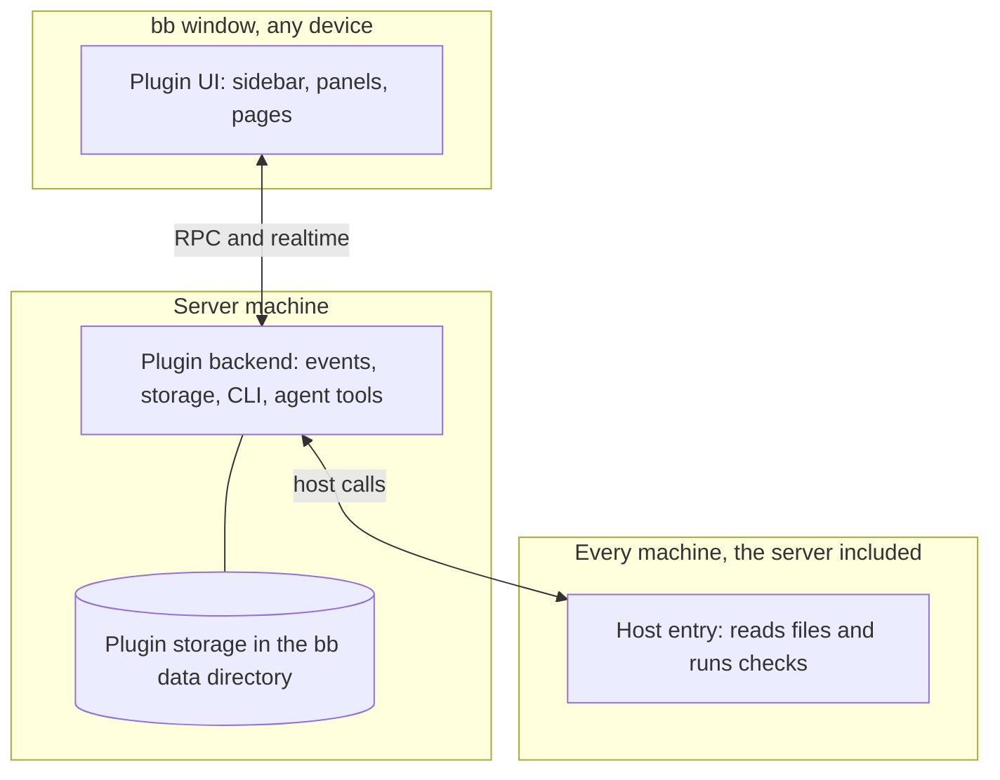

# How the plugins fit into bb

Each plugin is an ordinary bb plugin: a folder under `plugins/` with its own `package.json`, listed in [`.bb/plugins.json`](../../.bb/plugins.json) so `bb plugin install --plugin <name>` can pick it out of this repository. They share no code at run time and do not know about each other.

## Where each part runs

A bb plugin can have up to three parts, and the plugins use them differently.

| Plugin | Backend | UI | Host entry |
|---|---|---|---|
| Thread Glance | Keeps a lifecycle row per snoozed, parked or settled thread, the manual order, the settings and project colours and icons; settles threads on a 5-minute pass; reclaims put-away threads; serves project icons; keeps the workspace ports snapshot and signals port processes for Stop, the settle prompt and Clean | The sidebar thread list, thread menu actions, thread header buttons, a settings section | Lists listening ports inside workspaces and sends SIGTERM to a matched process, on every macOS and Linux machine |
| Thread Usage | Builds the ledger from bb's events, sweeps the gateway, prices turns; serves `bb thread-usage` and the `thread_usage` tool | Header chip, Usage tab, Thread usage page, settings section | Reads harness session logs on the machine that ran a thread |
| OpenAI-compatible inference | Keeps the Endpoints, registers an AI service per Endpoint, and reports whether each is ready; sends the Endpoints to the host entry; serves the section's calls and `bb openai-inference`; copies the Endpoints 0.3 saved in its settings once | A settings section, the Endpoints | Sends bb's AI tasks to the Endpoints, from the primary machine; keeps the literal keys |
| UI Tweaks | Keeps the two choices and announces a change to every window | The two settings rows; a content script that restyles bb's thread view and New-thread screen | none |
| Unattendish | Polls the forge and tracker of each registered fleet on an interval, sorts every change into woken, echo, out of scope or held, sends the manager one wake, and keeps the ledger; serves `bb unattendish` and the dashboard's calls | Fleets page, Fleet chip, Fleet tab, new-row toasts, settings section | none |

The **server machine** is the machine that runs the bb server and holds its data directory (`bb status` prints it as `Data dir`, for example `/var/lib/bb/.bb` on a server where bb runs as a service user). Every machine, the server machine included, runs bb's daemon, and all are listed under Settings → Machines. A backend always runs on the server machine; a host entry runs in the daemon of whichever machine the backend calls.

All five rely on plugin APIs that bb marks experimental, and need bb 0.46 and plugin SDK 0.6.37 (`engines` in each `package.json`). A bb upgrade that renames one of those APIs can stop a plugin loading until the plugin is updated; `bb status` warns when an enabled plugin is not running.

## What the plugins follow in bb

A plugin follows **bb core**, what bb itself does for every plugin through the SDK and the host: its thread actions, read, pin, archive and section state, project operations, how a new thread is created, and what the host passes the surface a plugin draws. Taking those as they are, rather than doing the same thing another way, is what lets a plugin keep working when bb changes them in a release. A plugin does something of its own only for a feature bb core does not have, such as Thread Glance's Snooze, Park and Settle, which bb core has no equivalent for.

A plugin that replaces another plugin is an alternative to it, not a copy. Thread Glance replaces the **built-in thread list**, the `thread-list` plugin bb ships. That plugin's preferences, row buttons, sort and folding are its own design rather than bb core, so Thread Glance keeps its own and neither reads nor copies the built-in list's; following another plugin's settings would mean following its format on every release. Where both lists use bb core, for example a thread's section or its archive, each shows the same state.

## Threads and trees

A **harness** is the coding agent a thread runs on, such as Claude Code, Codex, pi or Cursor; bb calls it the thread's provider.

A **child thread** is one another thread spawned: bb records the spawner as its **parent thread**. A thread with no parent is a **root**. A thread's **thread tree**, or **tree**, is the thread and every thread under it: its children, their children, and so on.

Thread Glance lists a child under its parent's card, so one busy parent thread does not push other work off the screen, and settles a tree as one piece of work. Thread Usage adds up a tree's cost, so a parent thread's figure includes what its workers spent. A **fork** (a thread started from another thread's history, side chats included) is not a child and is not in the tree: bb records it as a copy, not as delegated work.

## What each plugin stores

| Plugin | Where | What |
|---|---|---|
| Thread Glance | The plugin's key-value store on the server for the settings, and its own `<data dir>/plugins/thread-glance/data.db` for the rest; the browser's `localStorage` for shelf and group collapse, the Active sort, open child lists, the port link machine and caches, kept per device | The settings; a lifecycle row for each thread that is settled, parked or snoozed, or has an active override; the manual order; each project's colour override and uploaded icon; Clean's previews, for 2 minutes each |
| Thread Usage | `<data dir>/plugins/thread-usage/data.db` (SQLite) | Turn records, gateway rows, harness-log entries, the thread tree |
| OpenAI-compatible inference | The plugin's key-value store on the server for the Endpoints; `<data dir>/plugins/openai-inference/host-data/` on the primary machine, readable only by bb's user, for the rest | The Endpoints, with no literal key; `keys.json`, the literal keys; `learned-fields.json`, the request fields each Endpoint refused |
| UI Tweaks | The plugin's key-value store on the server | The text size and transcript width choices |
| Unattendish | `<data dir>/plugins/unattendish-sdlc/data.db` (SQLite) | Each fleet's registration, cursors and last poll state until unregistered, the Inbox rows it has seen and the dashboard's actions, 30 days of the ledger, which an unregistered fleet's keeps too, and the accounts, their pasted tokens and the assignments until removed in Settings |

`bb plugin uninstall` deletes a plugin's settings, secrets and schedules. Thread Usage's `data.db` stays, and a reinstall reads it again; so does Thread Glance's, with its lifecycle rows, manual order and project colours and icons. To start from nothing, delete `data.db` while the plugin is uninstalled. UI Tweaks' two choices stay in its key-value store until the next install clears them, so a reinstall starts at Medium. Unattendish's `data.db` stays too, with every registration, cursor and ledger row and every account with its stored tokens, because bb gives the plugin no signal when it is removed: a reinstall polls the registered fleets again with the accounts it finds. Removing every account in Settings before uninstalling deletes the tokens, as [what it stores](../reference/unattendish-settings.md#what-it-stores) says. OpenAI-compatible inference's Endpoints stay in its key-value store and its `keys.json` and `learned-fields.json` stay on the primary machine; [what stays after uninstalling](../reference/openai-inference-settings.md#what-stays-after-uninstalling) says how to delete them.

Thread Glance's first start after an upgrade from 0.11.2 removes the data that version stored: its time stamps, notes and preferences, in `data.db` and the key-value store, and the two keys it kept in the browser's `localStorage`, which a window removes by name when it loads. It recognises them by their shape, never by the installed version, so the shelf list's own data is kept through every later upgrade, including a copy installed from `@main` before 1.0.0, which still read 0.11.2. Pins, read state and archive state are bb's and are unchanged.

None of the five sends anything off the bb server except where you point it: Thread Usage fetches public price lists and reads your gateway; OpenAI-compatible inference sends bb's AI task prompts, which quote your thread prompts and diffs, to the Endpoints you select; Unattendish sends reads, and only reads, to the GitHub, GitLab, Linear or Jira Cloud hosts its accounts name.
