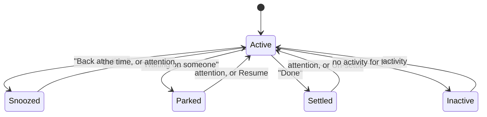
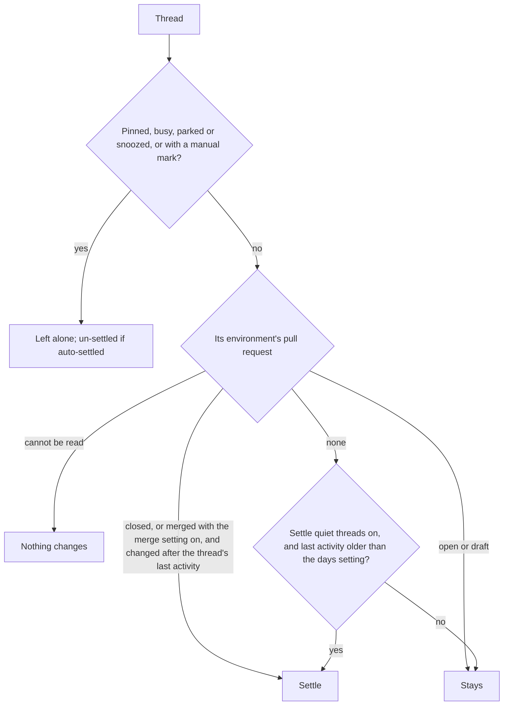

# Why Thread Glance keeps threads on shelves

Thread Glance is built around one idea: the list keeps a thread where you put it. An agent thread is rarely finished and rarely working; most of the time it waits for something: your answer, a colleague's reply, tomorrow, a merge. A list that only sorts by recent activity cannot tell those waits apart, so every thread you are not working on stays in view until time hides it. Thread Glance lets you say what a thread is waiting on, and the list moves it out of the way and brings it back when that wait ends.

[The list](../reference/thread-glance-list.md) has the exact rules; [actions](../reference/thread-glance-actions.md) has what each button does. This page says why they are shaped as they are.

## Three ways to put a thread away

Each verb answers a different question, and only the first two need you to name a time or a wait.

| Verb | The thread is | Comes back |
|---|---|---|
| **Snooze** | Something you will pick up at a known time: this evening, tomorrow | At that time, as [woke](../reference/thread-glance-list.md#woke), or earlier if the thread needs you |
| **Park** | Waiting on someone else to reply, with no time to name | When new attention arrives, or when you resume it |
| **Settle** | Done: the work is merged or no longer yours | When new attention arrives, or when you un-settle it |

Parking and settling have no timer. What ends them is new **attention**: bb's own signal that a turn ended or a question arrived. Comparing it with the moment you parked or settled means a reply you were waiting for brings the thread back without anyone watching a clock, and the same reply cannot be missed by a thread that "came back" too early. Attention also clears the mark, so a thread that returns and then goes quiet is not carried back to Parked or Settled by a stale mark, and a later [automatic settle](#automatic-settle) may take it again.

A snooze brings the thread back at its time. The thread then shows as **woke**, in bold, until you open or dismiss it: a wake you did not see should not look like any other active thread. The marker is derived from the same row in every window, so a reload or a second window shows the same thing.

## Active, Working and Inactive are worked out, not stored

Three of the shelves are not something you set. A thread with no lifecycle row is Active. Working and Inactive split what remains of Active by what the thread is doing and how long ago it did it. They are worked out each time, so there is nothing to undo or to go stale: a thread leaves Inactive the moment it has activity. Both skip a thread that needs you or is woke, because a question is the last thing to hide behind a "quiet" shelf. Pinning always wins: Pin is bb's action, and the shelf that shows a pinned thread is Pinned whatever Thread Glance has recorded.

## One busy rule

The buttons, the server's checks, automatic settle and Reclaim all ask the same question, [is the thread busy](../reference/thread-glance-list.md#busy-threads). A thread whose only sign of life is a running monitor has no turn in flight and no pending question, but its runtime is still active: stopping it would kill the monitor. Two rules that disagreed would offer a button the server then refused, or auto-settle a thread a person could not settle by hand. The server checks again when an action arrives, because a thread may have started a turn between opening a menu and choosing.

## Settling covers a tree

A thread tree is one piece of work: a parent's children are its workers. Settling the parent while a child works would hide work in progress, so a Settle covers the whole tree below the thread and fails if any thread in it is busy. It marks each thread, so the settled children are not listed under a live parent. Un-settle goes the other way: it reopens the thread's ancestors, so a thread you bring back is not left under a parent that is still settled.

The same holds when a child is created or starts a turn: its parked, snoozed or settled ancestors are reopened to Active, since a parent waiting for a child's work is not at rest.

## Automatic settle

Settling by hand does not scale across dozens of threads, so a server pass settles the ones that are over, every 5 minutes, when a list mounts and when one of its settings changes. It follows what bb knows of a thread's pull request:

- A closed pull request always counts; a merged one counts with **Settle merged pull requests** on. The pull request must have changed after the thread's last activity, so a thread you went back to after the merge is not settled over your head.
- An open or draft pull request keeps the thread, however old, since the work is not over.
- If bb cannot read the pull request, nothing changes: a wrong guess would hide a live thread.
- A thread with a manual mark (a manual settle, or the active override Resume and Un-settle set) is left alone, because you decided.
- A parent settles only when its whole tree is settled or settling.
- A pass that started under older settings is thrown away, and only one runs at a time with one more queued, so changing a setting never settles by the old one.

An automatic settle reclaims and shows no toast: nothing asked for it, so nothing interrupts. For the same reason it holds back a thread that still serves a port, and every thread of a machine it cannot scan: a dev server left running is a sign the work may not be over, and settling without a person there to answer the [prompt to close ports](../reference/thread-glance-actions.md#close-a-settled-threads-ports) would leave it running with nobody looking.

## Reclaim

A thread you put away is not coming back soon, and keeping its agent runtime and terminals running costs memory for nothing. So after a park, snooze or settle, Thread Glance stops the thread's runtime and closes the terminals nobody has typed into. It re-checks before each step that the thread is still unpinned, not busy and unchanged, because a person may have pinned it or started a turn since. It leaves a terminal that has had input, since that may hold a process you started. Stopping a runtime does not itself count as attention, so it does not bring the thread straight back.

Archiving from any bb menu also stops the thread's runtime and its idle children's runtimes, so archived work does not keep running. A working child is left alone.

## Ports belong to whoever started them

Agents start dev servers and watchers and leave them running. Thread Glance shows them so you can see what a thread left listening, and closes them only where it can tell whose they are. bb gives every process an agent starts the thread's id in `BB_THREAD_ID`, so a process naming exactly one thread that works in that environment is that thread's. Any other listener in the workspace, one you started yourself or one that names two threads, is shown and can be stopped by hand, but nothing closes it for you.

Reading other processes is the one thing in Thread Glance that reaches beyond bb, so it is held to what that needs: a host entry on each machine reads the listening sockets, and of each process its executable name, working directory, start time and the single `BB_THREAD_ID` entry. Its command line is used on the machine only to skip bb's own processes, and nothing else of it or of its environment is returned or logged.

A process is signalled only when the machine finds the same PID and start time on the port at the moment of the request: PIDs are reused, and a stop aimed at yesterday's dev server must not reach whatever holds its number today.

**Clean** is Reclaim's deliberate counterpart. Reclaim runs on its own, so it closes only terminals nobody typed into; Clean runs when you press it after a preview, so it closes every running terminal and the threads' owned ports. A thread sharing its workspace with live work is left out, since closing a shared workspace's terminals and ports would reach into a thread that is not done.

## Manual order

Active's default sort is an order you set. A sort by activity moves rows as work happens; a list you work through in order should not. So the order is one list on the server, which every window follows, and new threads go to its top. Three choices follow from that:

- **One list across projects and shelves.** Working and Inactive keep Active's order, so a thread that returns lands in its old slot. Pinned threads stay in the list, so unpinning returns a thread to its place.
- **Other sorts do not rewrite it.** Recent activity and Date created only change what is shown, and turn off reordering in Active, so a glance at a different sort cannot scramble the order you made.
- **Reordering a subset moves only that subset.** Dragging a project's thread in Project sort refills that group's places and leaves everything else where it was.

## What changed from 0.11.2

Earlier versions grouped threads by project, section or machine and let idle trees settle into a fold at the end of each group, so nothing recorded what a thread waited on and every thread stayed in view until it had been idle a day. The shelf list replaces that design entirely: a thread's place comes from its lifecycle, a thread that needs you stays on Active or Pinned, and the project is a scope on the whole list rather than a grouping of it.
