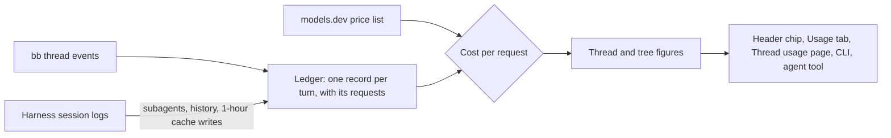

# How Thread Usage counts tokens and cost

bb reports how many tokens a thread used, but not what they cost, and not what the threads it spawned used. Thread Usage keeps its own record of every turn, prices each request from models.dev's list, and adds up [trees](how-the-plugins-fit-bb.md#threads-and-trees) when you ask.

## The ledger

The **ledger** is the plugin's own record of each turn: its model, tokens by kind (input, output, cache read, cache write, 1-hour cache write, reasoning), start and end, lines added and removed. It is built from bb's thread events as they arrive, and stored in the plugin's SQLite database. Cost is not stored: it is worked out when read.

It takes each turn's tokens from the per-request usage bb reports and adds them up itself. bb's own running total starts again from zero when the harness process restarts, so a sum of per-request figures is the one that stays right across restarts.

A turn recorded from those per-request events also keeps each request's own counts, in the order the requests were made, because a request's price depends on its own size, as [Prices](#prices) says. A turn stored as a sum, filled in from bb's running total, an opening balance, or collapsed by [retention](#retention) has no per-request counts.

bb keeps those per-request events only for a short while once newer ones arrive. A plugin that was stopped, or installed after a thread began, can find some already gone. The plugin notices the gap and fills it from bb's running total when the harness did not restart in between; otherwise it marks the thread's history as partial and reads the harness's own logs to fill it. The moment the plugin first read a thread is its **first seen** time; before it, usage comes from logs.

## Harness logs

Some usage never reaches bb's events. The plugin's host entry reads each harness's session logs on the machine that ran the thread, for three things:

- **Claude Code subagents.** Their requests run inside the same session but bb never counts them. They are stored under the turn whose time they fall in, or shown as **Outside turns** when they fall in none. Each is priced on its own, with its own 1-hour cache writes.
- **History** from before the plugin was installed, or from a gap.
- **Claude Code's 1-hour cache writes.** bb reports how many tokens a request wrote to the prompt cache, but not for how long, and a 1-hour write costs more than a 5-minute one. The plugin finds what share of the cache writes logged during a turn were 1-hour writes and takes that share of the turn's cache writes as bb counted them. A log line cannot be matched to one of bb's requests, so these writes are priced as a line of their own, as [Prices](#prices) says. The tokens themselves still come from bb's events.

Logs supply tokens, never dollars: a cost pi writes on a message is ignored. Codex logs are read for history and gaps only. Cursor, run through ACP, reports no tokens to bb and keeps no log the plugin reads, so its threads show no usage.

Reads are incremental: the host entry remembers how far it read each file and parses only what was appended. When a machine is offline, the thread is marked with the machine's name and the time, and read again when the Usage tab opens and every 15 minutes, so a missing log shows as missing, never as zero.

The **Read harness logs** setting turns this off. Subagent tokens are then not counted.

## Prices

Every dollar is an estimate: tokens times a price from [models.dev](https://models.dev)'s list. The plugin fetches the list daily and uses the copy bundled with it until a fetch has succeeded, and while **Refresh prices online** is off. Costs are worked out when read, not stored, so a price change moves the estimate of every past turn with it. A price is used as models.dev publishes it. Nothing else supplies a price.

Each request is priced on its own. Its **prompt** is its uncached input plus its cache read plus its cache write; output counts toward the dollars and not toward the prompt. A model's **tier** is the set of rates that replace its base rates for a whole request once the request's prompt is over a size models.dev publishes for it. The request uses the tier with the highest size its prompt is over, every kind the tier sets at the tier's rate and every kind it omits at the base. Output is charged at the tier's rate too. Pricing each request alone matters: three 40,000-token requests are three requests at the base rates, not one 120,000-token request at a tier.

A turn's dollars are the sum of its requests. A turn with no per-request counts cannot have a tier applied, so it uses the base rates and is marked approximate where its model has a tier, and Data quality says so: its dollars may be low. A tier is named only on a turn opened in the Usage tab, which lists the requests that used one, and in that Data quality note.

A Claude model's 1-hour cache write costs twice the input rate of the tier in effect, because models.dev publishes only the 5-minute rate. For a request a log records, that is the tier that request used. For a turn bb recorded, the 1-hour writes are priced as a line of their own at twice the input rate its requests used, or twice the highest of them, marked approximate, when they used more than one. Any other model's 1-hour writes use the cache-write rate of the tier in effect and are marked approximate.

A model with no price on models.dev is **unpriced**. Its tokens still show, labelled as such, because showing `$0.00` would read as free. A thread whose every token is unpriced leads with its token count, as a subscription thread does.

## Billed and subscription use

A thread's **billing mode** says how its tokens are paid for: with an API key, or on a subscription plan. On a subscription, tokens are not billed one by one, so a dollar figure would be misleading as a bill. The **headline** is the large figure at the top of the Usage tab and in the header chip's card, with its billing mode beside it. On a subscription, tokens lead the headline, and dollars are shown smaller as a **list-price equivalent**: what the same tokens would cost at public list prices. A tree that mixes both shows the billed dollars as its headline and the subscription tokens on a second line; the two sums are never added into one billed figure.

The plugin reads the billing mode from what the harness reports about its rate limits, and from how requests were routed. [Billing modes](../reference/thread-usage-cost-sources.md#billing-modes) lists the rules; the **Billing for** settings override them per harness.

## Trees, forks and deleted threads

A tree's figure is added up when read, from the plugin's own copy of the thread tree, because a thread can be moved under another parent at any time. That copy keeps deleted threads too: bb stops listing them, but their usage was spent, so a parent thread's figure does not drop when you delete one of its workers.

A fork starts with a copy of its source's history. Its own figure counts only the turns after it was created, and it appears under **Forks of this thread** in the Usage tab, outside the tree.

## Retention

Records older than 365 days are collapsed into one total per thread, which keeps no per-request counts. The database stays on the server after an uninstall, and a reinstall picks it up again.
