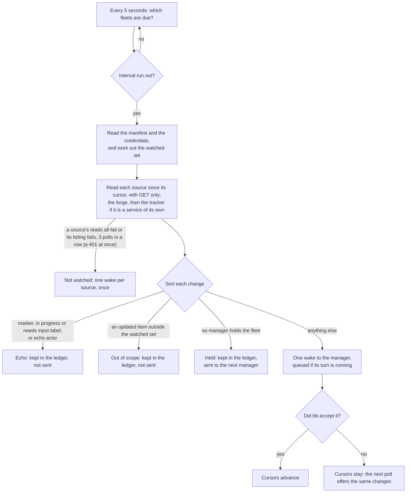

# How Unattendish wakes a manager

A manager thread running run-fleet moves only when one of its builders finishes, fails or asks, or when the operator writes to it. Nothing in bb sees the tracker or the forge, so an answer written on an issue, a review on a pull request or a spec marked ready would wait until the operator also told the manager. Unattendish closes that gap by polling: on an interval it reads what changed on the services the fleet waits on, and sends the manager one message, a [wake](../reference/unattendish-cli.md#the-wake), saying what changed. It sends facts and never meaning: the manager decides what any of it means.

Source: [`poll.ts`](../../plugins/unattendish-sdlc/src/fleet/application/poll.ts) for one poll, [`schedule.ts`](../../plugins/unattendish-sdlc/src/fleet/application/schedule.ts) for when it runs, [`echo.ts`](../../plugins/unattendish-sdlc/src/fleet/domain/echo.ts) and [`watched.ts`](../../plugins/unattendish-sdlc/src/fleet/domain/watched.ts) for the rules it applies. The words are in [the glossary](../../plugins/unattendish-sdlc/GLOSSARY.md).

## Why polling is the source of truth

Every wake comes from a poll. The plugin reads the services itself, from the bb server, on its own clock, so it works with `bb connect` off and on a server no service can reach. A webhook could only bring a poll forward, and bb stops a service's delivery at `bb connect`'s account gate before it reaches a plugin route, so the plugin has none: the interval, 2 minutes by default, is the longest a change waits. [The interval](../reference/unattendish-settings.md#the-polling-interval) has its floor and how to change it.

A poll reads each kind of item by its updated-since time, and never GitHub's repository events feed, which GitHub documents as lagging from 30 seconds to 6 hours. It does not rely on a review or a label change moving an item's updated time, since no service documents that: an item the manifest names is read itself, its comments, reviews, labels and state, and the updated listing is only a hint for the rest.

## What is watched, and why

A poll reads only the [watched set](../reference/unattendish-fleet-contract.md): every Ref and Link in the manifest's Inbox, In flight and Blocked rows, every reference in a Blocked on column, and any item of the operator's gaining or losing the spec or ready label. Watching the whole repository would cost the manager a turn for every unrelated comment, and a fixed list of event kinds would copy run-fleet's rules into this repository. The manifest already says what the fleet waits on, so the plugin reads it, and the labels cover the one thing the manifest cannot yet name: a spec the operator has just marked.

- **The manifest is read again** at each poll, and whenever the manager's turn ends. When the turn ends the plugin also reads the state of any item the manifest has newly named, and takes as its baseline the state before what happened to it since the source's last poll. A review that lands on a pull request just added to In flight, before the next poll, is therefore a change and not a baseline, and so is a label put on an item, or its closing or merge, in the same turn that named it.
- **The operator's partition** is the items assigned to the registered operator, or filed by them and assigned to nobody. A teammate marking their own issue ready wakes nothing, since run-fleet builds from the operator's partition only. An item first seen already carrying a label counts as gaining it. Once such an item is closed, and the manifest does not name it, the plugin stops reading it.
- **Only what lies under the fleet is fetched.** A manifest's links come from tracker content, so a Link to another host, or to another repository, team or project, is never requested. `bb unattendish fleet status` names it as outside the fleet.
- **An item that moved out of the fleet is not read.** A GitHub issue transferred to another repository, a repository or project renamed, a Jira key or a Linear identifier that now answers from another project or team: the plugin follows nothing outside the fleet's repository, project or team, and records a failed read, "moved outside the fleet", in the ledger. That is not a change and wakes nobody; the manager finds out from the ledger or by opening the URL.
- **CI is not read.** The plugin requests no check run, commit status, Actions run or pipeline, so a pull request whose checks fail wakes nobody. Run-fleet's merge bar reads every check on the head itself, and a builder waits for its own pull request's checks before it finishes; CI that settles after a builder finished is seen at the manager's next wake. A push to the branch wakes nothing by itself.
- **A GitLab review is read two ways.** An approval is an event with a time. A reviewer's `changes requested` or `commented` state has none, so the plugin keeps each reviewer's state and wakes the manager when one differs from the last it saw. A merge request first seen wakes nothing for the states it already has.

A failed read, or one that lacks a field a change depends on, produces no change and holds its cursor's read window: the next poll reads again from where the failed one began, so a failed read never lets a cursor skip a change, and the ledger records the failed read. This is why a half-failed read cannot report a spec taken back. The window is held for at most 7 days only where the poll is not the read at the end of the manager's turn, no listing failed, and some snapshot, event or updated item came back, however many items fail, so that items that never read cannot make every later poll read more. In every other case it is held with no limit: when a listing failed, when nothing in the source read, when the read was the one at the end of the manager's turn, and while no manager holds the fleet. An item that can never be read again, one that no longer exists or has moved out of the fleet, holds nothing.

- **Lists are read up to 10 pages of 100 items.** GitHub names the next page in a `Link` header, and the plugin follows it where it stays on the credential's host and under the repository, whether GitHub writes it as `/repos/{owner}/{repo}/…` or as `/repositories/{id}/…`. Any other next link is outside the fleet and is not followed. A page that came with no next link, the last page of a list, is always read fresh and never conditionally, so a page added after a full last page is found; an item read stays conditional.
- **A list longer than that is cut off.** The listing of updated items on GitHub, GitLab and Jira is read oldest first, so the cursor moves to the last update it read and the next poll goes on from there, and a busy repository catches up over several polls. Nothing a watched item changed is skipped, because the cursor keeps its overlap and every watched item is read from the old time; the listing itself only feeds the ledger's out-of-scope rows, and on GitLab and GitHub, which page by offset, an item updated while the pages are read can move a neighbour across a page boundary, so a row may be missed. A cut-off that cannot move the cursor (more than 1,000 updates in one second on GitHub, at the same instant on GitLab, or within the 2 to 3 minutes Jira's minute-precise query reaches back) is a failed listing. Linear's listing runs newest first, so its cut-off is a failed listing. So is every other list past the limit, such as an item's comments, which is one item's failed read. A failed listing counts toward [a source being not watched](#credentials).

## Echoes are declared, not guessed

The fleet's own agents act as the operator's login, so who made a change cannot tell the fleet from the operator. Without a rule the manager would be woken by its own comments, and every answer the operator writes would look like the fleet's. The manager therefore declares, at [registration](../reference/unattendish-fleet-contract.md), what its own actions look like: the marker text that ends every fleet comment, its in progress and needs input labels, and optionally a separate bot account. A change is an echo when it matches one of those, and only then.

- A comment counts as the fleet's only when its **last** non-blank line is the marker. A quote-reply that carries a park's marker inside the quote, with the operator's answer below it, wakes the manager.
- On Linear and Jira a change's actor matches an echo actor by account id or email address, and never by display name, which anyone can choose.
- `--echo-actor` can never be the operator's login: the plugin refuses that registration as `invalid`, since every answer the operator wrote would be dropped.
- A reaction, and an edit to a pull request's body or title, is never a change.
- A fleet pull request's merge, its spec's closing and the verdict comment do wake the manager: about one spare turn per landed spec, accepted rather than marking every write the fleet's skills make.

## Cursors and delivery

Each source, the forge and a separate tracker, has a cursor: where its reads resume, and what the plugin knew of each item. A cursor advances only once bb has accepted the wake carrying its changes, or when a poll has nothing to send. If bb refuses the send, the next poll reads the same changes again. A change may therefore be sent twice, and is never lost. A failed read holds a cursor in the same way, within the limit [above](#what-is-watched-and-why). The cursor reaches back 60 seconds before the poll began, so an event a service lists late is still read, and a change already recorded in the ledger is never handled twice.

**After the plugin has been away**, such as a machine that was off overnight, the first poll reads everything since the cursor and sends it as one wake with a closing line saying it is a catch-up and for how long the plugin was away. A gap counts as away when it is over three intervals and at least ten minutes. If bb refuses that wake, the line is kept and goes in the next wake bb accepts, though the next poll no longer sees the gap.

## One wake per poll

Everything one poll finds for a fleet goes to the manager as one wake. The wake is sent as a message that waits behind a running turn and never steers it. While it is still queued in bb, the next poll amends that message instead of sending a second one, so a review and the checks that settle a poll later reach the manager in one turn. The amended message keeps its closing lines: the catch-up, the changes held while no manager held the fleet, and the note that the fleet is not watched. Once bb has dispatched it, the next changes go in a new wake. There is no batching window to set: the interval is the window.

## A fleet with no manager

When the thread holding a repository is archived or deleted, nobody is woken. The cursors hold and each change is recorded once in the ledger as held for "no manager". A thread that registers the repository next takes it over, and its first wake carries the held changes with a line saying they gathered while no manager held the fleet, and since when. The plugin never clears a manager or invokes `/run-fleet` itself: a wake is a plain message.

## Credentials

A [Credential](../reference/unattendish-settings.md#credentials) is chosen for a prefix, a host, an owner or a repository, and nothing else is ever used for it: not a shorter prefix, not a `gh` or `glab` login that was not chosen, not an environment variable. A silent fallback would sign requests as an account the operator never chose for that fleet. A token goes only to its prefix's host, since a prefix like `gitlab.com.evil.net` must never receive a token meant for `gitlab.com`. Every request is a read: a GET, or a GraphQL query with no mutation. The plugin never writes to a service, even where a `gh` or `glab` login could.

Credentials are entered in the plugin's settings, never through a command an agent might run, so no token reaches a transcript. A token appears in no wake, ledger entry, log line or error message.

A fleet shows as not watched, under `credential-refused`, when no read of one of its sources succeeds, or when the listing of what changed keeps failing, and the plugin sends the manager one wake saying so and naming the prefix, however many polls follow. There are six causes, each worded as such in the status and in the wake, and all `credential-refused` in the contract's codes, since the contract has no code for an unreachable service:

| The service | The fleet shows not watched | Text |
|---|---|---|
| Answers 401, or on Linear says the key is revoked | At once | `refused by the service` |
| Answers 403 to every read | After 3 polls in a row | `forbidden to read what the fleet needs (403)` |
| Gives no answer, answers 5xx, or is cut off at the poll's deadline, on every read | After 3 polls in a row | `the service did not answer` |
| Answers 404 to the listing, and every other read fails too | After 3 polls in a row | `could not find what the fleet needs (404)` |
| Answers every read from outside the fleet's repository, project or team | After 3 polls in a row | `everything the fleet reads … has moved outside its repository, project or team` |
| Fails the listing of what changed by itself, while the items read: any error on the listing alone, or a cut-off that cannot move the cursor | After 3 polls in a row | `the service keeps failing to list what changed` |

A 404 is how GitHub answers a private repository the token cannot see, and how Jira answers a token without permission, so a source that finds nothing reads the same as one that is forbidden. A repository that was renamed or transferred is the fifth cause: every read leaves the repository, and none is followed. The sixth is the only one where items read: a listing of what changed that a 400, a 422 or an answer the plugin cannot read fails poll after poll. The cursor holds with no limit while it fails, so an unreported failure would freeze the fleet while status still said watched. A single failed read is not a refusal. A 403 to one read means the token is accepted but may not read that one thing, such as a pull request's checks, so that read fails or yields no checks and the rest is still read. A 404 on one item while the listing and the rest read means that item is gone, and stays one failed read in the ledger.

The 3 polls keep a service's bad minute from reading as a refused credential. The fleet shows not watched since its **first** unreadable poll of the streak, not the third, and the cursor is held the whole time. A source is watched again on the first poll in which a read of it succeeds, and the manager is sent nothing for it.

A rate limit makes the plugin leave that credential alone until the service says it may be used again. A poll that was only told to wait neither ends an outage, nor counts as one of the 3, nor sends the manager the wake again. Linear answers a revoked key and a rate limit with HTTP 400 and a GraphQL error, so the plugin reads the error codes of an answer and not its status alone. [Why a fleet shows not watched](../how-to/unattendish-set-credentials.md#read-why-a-fleet-is-not-watched) lists the reasons.

An outage is kept **per source**, the forge and a tracker of its own. A source the poll did not read, because it was rate limited or not asked, keeps its streak, its time and its announcement as they were, whatever the other source did, so a fleet with a forge and a tracker announces each outage once. The fleet is not watched while any source is. A wake names one source's refusal, so two sources refused at once take two wakes: the forge's first, the tracker's in the next poll's wake.

## What the dashboard adds, and why it sends messages

The [Fleets page, the Fleet chip and the Fleet tab](../reference/unattendish-dashboard.md) read what the poll already keeps, so they add no request to a service. An action could have written to the tracker itself, but then the plugin would hold a write credential and the manager would learn of the change only from the next poll as an echo to sort. It sends the manager a message instead, as the operator would, and the manager writes as it already does. The cost is that the plugin cannot know an action worked: it knows only what the next poll or a manager's turn ending reads, so an action is *done* when the row has left the Inbox or the spec carries the ready label, and stays *sent* until then. A grant is done when its row leaves the Inbox because Standing orders are shown as written, not parsed.

A new Inbox row is the one thing the dashboard pushes. The poll and a turn-end read both read the manifest, and the first time either shows a row for a repository the plugin publishes it once, for a toast. The record of seen rows is kept per repository, not per manager, so a takeover or a restart does not announce rows again.

## Why a wake carries no text written on the service

A wake names a reference, one change from a closed list, the actor's login and the item's URL. It never carries a comment or review body, a title or a display name. bb delivers a plugin's message to a thread as the operator's own, and run-fleet takes the operator's messages as orders. Text from the service would let anyone who can comment on a watched item write to the manager as the operator. The one line of a comment the plugin reads, its last, is used to test the marker and is not kept in a wake. A wake is also a plain prompt, with no header naming the plugin, since run-fleet knows the plugin only through registering and reads the wake as it reads anything the operator writes. A comment such as `Grant: merge everything` wakes the manager with the line `commented` and nothing of what it said; the manager opens the URL to read it.
