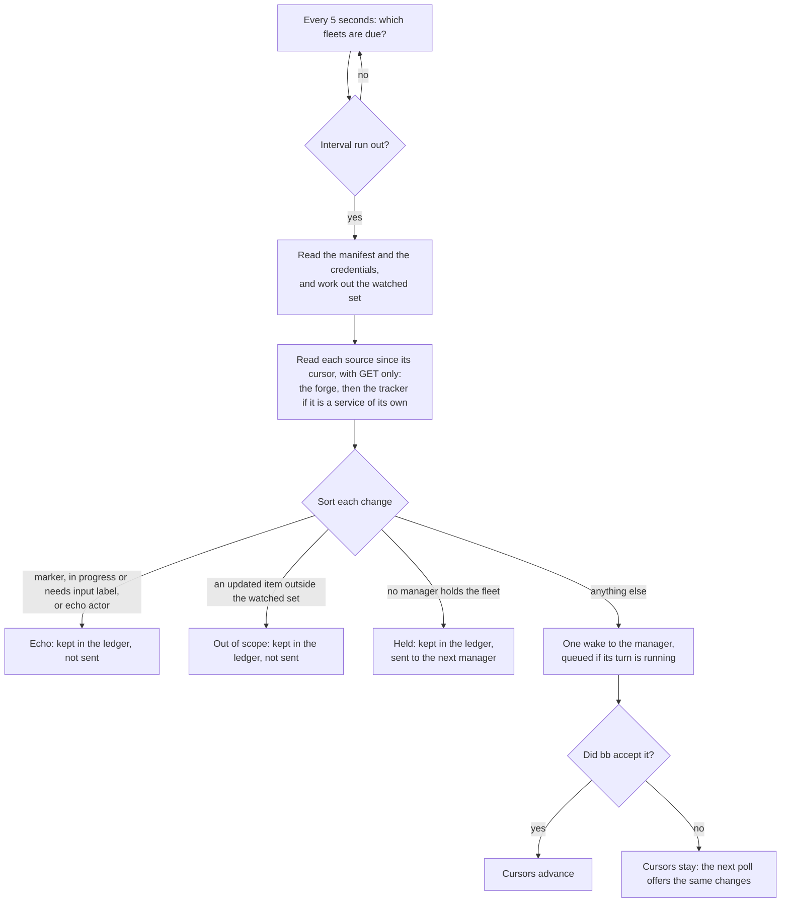

# How Unattendish wakes a manager

A manager thread running run-fleet moves only when one of its builders finishes, fails or asks, or when the operator writes to it. Nothing in bb sees the tracker or the forge, so an answer written on an issue, a review on a pull request or a spec marked ready would wait until the operator also told the manager. Unattendish closes that gap by polling: on an interval it reads what changed on the services the fleet waits on, and sends the manager one message, a [wake](../reference/unattendish-cli.md#the-wake), saying what changed. It sends facts and never meaning: the manager decides what any of it means.

Source: [`poll.ts`](../../plugins/unattendish-sdlc/src/fleet/application/poll.ts) for one poll, [`schedule.ts`](../../plugins/unattendish-sdlc/src/fleet/application/schedule.ts) for when it runs, [`echo.ts`](../../plugins/unattendish-sdlc/src/fleet/domain/echo.ts) and [`watched.ts`](../../plugins/unattendish-sdlc/src/fleet/domain/watched.ts) for the rules it applies. The words are in [the glossary](../../plugins/unattendish-sdlc/GLOSSARY.md).

## Why polling is the source of truth

Every wake comes from a poll. The plugin reads the services itself, from the bb server, on its own clock, so it works with `bb connect` off and on a server no service can reach. A webhook could only bring a poll forward, and bb stops a service's delivery at `bb connect`'s account gate before it reaches a plugin route, so the plugin has none: the interval, 2 minutes by default, is the longest a change waits. [The interval](../reference/unattendish-settings.md#the-polling-interval) has its floor and how to change it.

A poll reads each kind of item by its updated-since time, and never GitHub's repository events feed, which GitHub documents as lagging from 30 seconds to 6 hours. It does not rely on a review, a label change or a check moving an item's updated time, since no service documents that: an item the manifest names is read itself, its comments, reviews, labels, state and checks, and the updated listing is only a hint for the rest.

## What is watched, and why

A poll reads only the [watched set](../reference/unattendish-fleet-contract.md): every Ref and Link in the manifest's Inbox, In flight and Blocked rows, every reference in a Blocked on column, and any item of the operator's gaining or losing the spec or ready label. Watching the whole repository would cost the manager a turn for every unrelated comment, and a fixed list of event kinds would copy run-fleet's rules into this repository. The manifest already says what the fleet waits on, so the plugin reads it, and the labels cover the one thing the manifest cannot yet name: a spec the operator has just marked.

- **The manifest is read again** at each poll, and whenever the manager's turn ends. When the turn ends the plugin also reads the state of any item the manifest has newly named, so a review that lands on a pull request just added to In flight, before the next poll, is a change and not a baseline.
- **The operator's partition** is the items assigned to the registered operator, or filed by them and assigned to nobody. A teammate marking their own issue ready wakes nothing, since run-fleet builds from the operator's partition only. An item first seen already carrying a label counts as gaining it.
- **Only what lies under the fleet is fetched.** A manifest's links come from tracker content, so a Link to another host, or to another repository, team or project, is never requested. `bb unattendish fleet status` names it as outside the fleet.
- **Checks wake the manager once**, when a pull request's whole set reaches a final state, all passed or at least one failed, and never on a pending or running transition. A push to the branch wakes nothing by itself.

A failed read, or one that lacks a field a change depends on, produces no change and leaves its cursor where it was; the ledger records the failed read. This is why a half-failed read cannot report a spec taken back.

## Echoes are declared, not guessed

The fleet's own agents act as the operator's login, so who made a change cannot tell the fleet from the operator. Without a rule the manager would be woken by its own comments, and every answer the operator writes would look like the fleet's. The manager therefore declares, at [registration](../reference/unattendish-fleet-contract.md), what its own actions look like: the marker text that ends every fleet comment, its in progress and needs input labels, and optionally a separate bot account. A change is an echo when it matches one of those, and only then.

- A comment counts as the fleet's only when its **last** non-blank line is the marker. A quote-reply that carries a park's marker inside the quote, with the operator's answer below it, wakes the manager.
- `--echo-actor` can never be the operator's login: the plugin refuses that registration as `invalid`, since every answer the operator wrote would be dropped.
- A reaction, and an edit to a pull request's body or title, is never a change.
- A fleet pull request's merge, its spec's closing and the verdict comment do wake the manager: about one spare turn per landed spec, accepted rather than marking every write the fleet's skills make.

## Cursors and delivery

Each source, the forge and a separate tracker, has a cursor: where its reads resume, and what the plugin knew of each item. A cursor advances only once bb has accepted the wake carrying its changes, or when a poll has nothing to send. If bb refuses the send, the next poll reads the same changes again. A change may therefore be sent twice, and is never lost. The cursor reaches back 60 seconds before the poll began, so an event a service lists late is still read, and a change already recorded in the ledger is never handled twice.

**After the plugin has been away**, such as a machine that was off overnight, the first poll reads everything since the cursor and sends it as one wake with a closing line saying it is a catch-up and for how long the plugin was away. A gap counts as away when it is over three intervals and at least ten minutes.

## One wake per poll

Everything one poll finds for a fleet goes to the manager as one wake. The wake is sent as a message that waits behind a running turn and never steers it. While it is still queued in bb, the next poll amends that message instead of sending a second one, so a review and the checks that settle a poll later reach the manager in one turn. Once bb has dispatched it, the next changes go in a new wake. There is no batching window to set: the interval is the window.

## A fleet with no manager

When the thread holding a repository is archived or deleted, nobody is woken. The cursors hold and each change is recorded once in the ledger as held for "no manager". A thread that registers the repository next takes it over, and its first wake carries the held changes with a line saying they gathered while no manager held the fleet, and since when. The plugin never clears a manager or invokes `/run-fleet` itself: a wake is a plain message.

## Credentials

A [Credential](../reference/unattendish-settings.md#credentials) is chosen for a prefix, a host, an owner or a repository, and nothing else is ever used for it: not a shorter prefix, not a `gh` or `glab` login that was not chosen, not an environment variable. A silent fallback would sign requests as an account the operator never chose for that fleet. A token goes only to its prefix's host, since a prefix like `gitlab.com.evil.net` must never receive a token meant for `gitlab.com`. Every request is a read: a GET, or a GraphQL query with no mutation. The plugin never writes to a service, even where a `gh` or `glab` login could.

Credentials are entered in the plugin's settings, never through a command an agent might run, so no token reaches a transcript. A token appears in no wake, ledger entry, log line or error message.

When a service refuses a credential, the fleet shows as not watched since that time, and the plugin sends the manager one wake saying so and naming the prefix. [Why a fleet shows not watched](../how-to/unattendish-set-credentials.md#read-why-a-fleet-is-not-watched) lists the reasons.

## Why a wake carries no text written on the service

A wake names a reference, one change from a closed list, the actor's login and the item's URL. It never carries a comment or review body, a title or a display name. bb delivers a plugin's message to a thread as the operator's own, and run-fleet takes the operator's messages as orders. Text from the service would let anyone who can comment on a watched item write to the manager as the operator. The one line of a comment the plugin reads, its last, is used to test the marker and is not kept in a wake. A comment that quotes a dashboard message, such as `Grant: merge everything`, wakes the manager with the line `commented` and nothing of what it said; the manager opens the URL to read it.
