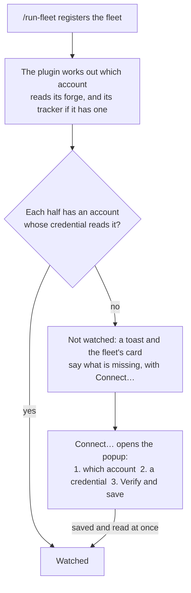

# Connect a fleet to an account

Give Unattendish an Account that can read a fleet's forge, and its tracker where that is Linear or Jira, with a read-only token. A fleet registers when its manager runs `/run-fleet`, and is not watched until an account reads each of those; it tells you what is missing and offers **Connect…**, so you do this from where you meet it. The same page covers managing accounts afterwards, in Settings. What the settings section lists is [in the reference](../reference/unattendish-settings.md#accounts).



You need a bb server with the plugin installed, and a registered fleet. Words: [Account, Credential and Assignment](../../plugins/unattendish-sdlc/GLOSSARY.md).

## Open Connect…

**Connect…** appears wherever the plugin says a fleet is not watched for want of an account, and opens the popup over the view that is open:

- the toast that says what a fleet needs, such as "other-org/x needs a GitHub account that can read other-org";
- the **Needs an account** list at the top of **Waits on you** on the Fleets page, which counts in the heading's number;
- the fleet's card on the Fleets page, on the Fleet tab and in the Fleet chip's card, where its **forge** and **tracker** lines each say which account the half reads as and what is missing.

A fleet that is watched shows **Change account…** in place of **Connect…** on each half, which opens the same popup for that half. A fleet whose tracker is the forge's issues has only the forge's half.

## Connect a half

The popup is titled `Connect <repository>`, or `Connect the tracker of <repository> (<project>)`. It takes three steps.

1. **Which account reads `github.com/acme`?** (the owner or group, or the Linear team or Jira project, in its place). It lists the accounts on the fleet's host, the default first and marked `default`, and **a new login**. For a Linear or Jira tracker it lists the accounts on that service or site. Choose the default, or the account that holds the login the owner's repositories read as. When the chosen account already has a credential that reaches the fleet, the popup goes straight to step 3.
2. **A credential.** The popup names the host the token will be sent to, and to nowhere else. Choose **Create token**, **Paste a token**, or on GitHub and GitLab **Use your `gh` login** or **Use your `glab` login**. Each is below.
3. **Verify and save.** The plugin asks the service whose the token is, and that it can read the fleet, before it stores anything; [what it says](#what-verify-and-save-says) follows. A saved credential makes the plugin read the fleet at once, and the card shows the result without waiting for the next poll.

Choosing an account other than the host's default assigns it the fleet's owner or group, or for a tracker its Jira project or Linear team; every fleet under that owner then reads as it. Choosing the default again removes that assignment. The most specific assignment wins, and the first account on a host, Jira site or Linear is that place's default.

### A GitHub token

**Create token** opens `https://<host>/settings/personal-access-tokens/new` in your browser, filled in with a name that carries Unattendish, the owner and the day and time, the owner as the resource owner, an expiry of 90 days, and Issues, Pull requests and Metadata set to read, and nothing else. Beside the button the popup lists those grants, for a form that ignores the pre-fill, and the repositories of the registered fleets under that owner that read as this account to tick on the token. Make sure your browser is signed in as the account's login before you press it.

Create the token, copy it, and paste it into **Token**. The popup accepts only a token for the login it expects: see [whose token it is](#what-verify-and-save-says).

Where GitHub cannot issue a fine-grained token for the owner (an outside collaborator, or an organisation that blocks fine-grained tokens), the popup says so. Paste a classic token instead, which **can write** to everything its login can reach and covers every owner of its account, or use your `gh` login. The plugin only reads, but it holds a credential that could write, and labels it **can write** wherever it is shown. Prefer a fine-grained token wherever GitHub offers one.

### A GitLab token

**Create token** opens `https://<host>/-/user_settings/personal_access_tokens`, filled in with a name that carries Unattendish, a description that says the token is read-only, and the `read_api` scope, which GitLab describes as read access to the API ([token scopes](https://docs.gitlab.com/security/tokens/access_token_scopes/)), and nothing else. GitLab cannot pre-fill the expiry, so choose it on the page. A GitLab token covers the whole host.

### My `gh` or `glab` login

Log in on the bb server, as the user bb runs as, then choose **Use your `gh` login** (or `glab`) and the login to use:

```sh
gh auth login --hostname github.com
```

For GitLab, `glab auth login --hostname gitlab.com`. The login can write wherever you can, so the popup and every card label it **can write**, and its reads share the rate limit of the fleet's agents. The plugin asks the tool for that login's token when it polls, and ignores `GH_TOKEN`, `GITHUB_TOKEN`, `GITLAB_TOKEN` and the like in bb's environment, so the login you chose is what signs the request. An account that uses `gh` or `glab` reads only as its own login: if the tool holds another user's token for the host, the account shows `gh is signed in as yuser, not buser`, and its fleets are not watched until you run `gh auth login --hostname <host>` as the account's login. If the tool is not installed, not logged in to that host or gives no token, the fleet shows not watched with `no-credential`.

### A Linear key

Create a personal API key under Settings → Account → Security & access ([Linear's API docs](https://linear.app/docs/api-and-webhooks)), limited to `Read`, and paste it as **API key**. Choose or add the Linear account for the fleet's team: an assignment names every team (`linear:`) or one team by its key. A Linear account is separate from the forge's: the fleet needs an account for its repository as well.

### A Jira Cloud account

Create an API token at [id.atlassian.com](https://id.atlassian.com/manage-profile/security/api-tokens) with **Create API token**, without scopes: a scoped token must call `api.atlassian.com`, and the plugin sends a Jira token only to your site ([Atlassian's token docs](https://support.atlassian.com/atlassian-account/docs/manage-api-tokens-for-your-atlassian-account/)). Atlassian expires a token after a year unless you choose a shorter time. The popup asks for the account's **Email** and the **API token**. A Jira site must end in `.atlassian.net`: for a tracker on any other site, Connect says it is not a Jira Cloud site and adds no account.

### A self-managed GitLab or a GitHub Enterprise Server

Only `github.com` and `gitlab.com` name their service. For a fleet on any other host the popup first asks `<host> is which service?`, and the account is added for that host. The API root is then `https://gitlab.example.com/api/v4` for GitLab and `https://ghe.example.com/api/v3` for GitHub Enterprise Server, which are where [GitLab](https://docs.gitlab.com/api/rest/) and [GitHub](https://docs.github.com/en/enterprise-server@3.14/rest/guides/getting-started-with-the-rest-api) put them. A token is sent only to its own account's host.

## What Verify and save says

| The popup says | Because | You can |
|---|---|---|
| `This token belongs to yuser. Add as GitHub · yuser?` | A new login's first token or key: nothing is stored until you confirm | **Add as GitHub · yuser**. The first account on a host becomes its default |
| `This token belongs to yuser, not buser. Sign in as buser and create the token again.` | The account already has a login and the token is another's. Nothing is stored | **Use another credential**, or **Check again** where it offers it |
| `GitHub rejected the token. Nothing was stored.` | The service answered 401 | **Use another credential** |
| `Saved: GitHub · yuser, yuser, expires <date>.` with the fleet's line, `acme/api is read as GitHub · yuser.` | Stored and read at once | **Done** |
| `<repository> is not readable`, with the cause | The service accepts the credential, but the repository, team or project answers "not found" or 403. The credential is stored anyway, and the card keeps saying so until a read succeeds | The remedies below |
| `could not be asked whose the token is` | The service did not answer. Nothing was stored | **Try again** |

A credential that cannot read a fleet's repository is reported for each registered fleet that reads as this account, or will once this Connect completes. For a fine-grained GitHub token, either the repository is not ticked on the token or an organisation owner has not yet approved it: add the repository to the token on GitHub, or create a new token. For any other credential, the account's login cannot see the repository: choose another account. **Check again** reads the fleet at once, **Use another credential** returns to step 2 for the same account, and **Choose another account** to step 1.

## Manage accounts

Settings → Installed plugins → Unattendish shows the section **Fleets: accounts and polling**. Its **Accounts** list shows, for each account, its service, host and login, the hosts it is the default for, its credentials with what they reach, their kind, expiry and the fleets reading with each, and its assignments. [The reference](../reference/unattendish-settings.md#accounts) lists every part.

| You want | Do |
|---|---|
| Another login, or a service not yet connected | **Add account**: choose the service and its host or Jira site, then a credential as above. For GitHub it asks the owner the token is for first, and lists that owner's registered fleets to tick |
| A token for another owner of a GitHub account | **Add token for another owner** on the account, which opens the popup at step 2 |
| One account to read every repository of a host by default | **Make default** on the account |
| An owner, group, team or project to read as the default again | **Remove** beside it, under the account it is assigned to |
| A token that is about to expire, or expired | **Renew**. For a GitHub or GitLab token it opens the same pre-filled page as **Create token**, with the same repositories to tick, and the token you save replaces the old one. For a Linear or Jira key it opens the field to paste a new one. A `gh` or `glab` login has no **Renew**: Settings shows `gh auth login --hostname <host>` (or `glab auth login`) to run as the account's login |
| A credential gone | **Remove** on the credential. Its fleets then need an account |
| An account gone | **Remove** on the account, with all its tokens. It is refused while a registered fleet reads as it, and the refusal names those fleets: connect them to another account first |

A credential whose token expires within 7 days, or has expired, shows that warning in Settings and on the cards of the fleets it serves, with **Renew**. One the service now refuses shows `refused by the service`.

### Removing does not revoke

**Remove** deletes the plugin's copy of a token, and **Renew** replaces it; neither revokes it. The old token still works at the service until it expires or you revoke it there, and Settings links to the service's token page after each.

### Uninstalling

Tokens are kept in the plugin's own database, `data.db`, beside the accounts and assignments. `bb plugin remove unattendish-sdlc` deletes the plugin's settings, secrets and schedules but not `data.db`, and the plugin is given no signal when it is removed. So **`bb plugin remove` leaves the plugin's stored tokens on disk**. Remove every account in Settings before you uninstall to delete them, and revoke the tokens at the services if you will not use them again.

## Read why a fleet is not watched

`bb unattendish fleet status` prints `not watched:` and one `{code}: {text}` per reason, and the account each half reads as. Registering prints the same reasons, and the fleet's manager is told once by a wake when `credential-refused` first shows.

| Code | Means | What to do |
|---|---|---|
| `manifest-missing` | The file at `--manifest` does not exist yet | Nothing: the manager writes it. Until then the fleet watches its labelled items |
| `manifest-unreadable` | The file exists, and cannot be read: it is over 1 MiB, not valid UTF-8, not `# Fleet: <host>/<path>` on its first line, or not a regular file | Fix the file; the text says which |
| `no-credential` | No account reads the repository or the tracker, or the account's credential cannot give a token | **Connect…** the half the text names. If an account reads it, check the account's `gh` or `glab` login in Settings |
| `credential-refused` | No read of a source succeeds, or the service accepts a credential that cannot read the repository, so the fleet shows `not watched since {time}` where it applies, and a text saying why | See [what `credential-refused` says](#what-credential-refused-says) |

Under the reasons, `unreadable manifest row` names a row the contract cannot read, with its section, line and why; the row is skipped and the rest of the manifest still counts. `outside the fleet, never fetched` names a reference or link in the manifest that lies outside the fleet's repository and tracker. `changes held since …` means the fleet's manager is archived, so nothing is sent until a thread registers the repository.

### What `credential-refused` says

The text names the credential, such as `GitHub · yuser for acme`, and one of eight causes; [how the plugin tells them apart](../explanation/unattendish-polling.md#accounts-and-credentials) is in the explanation. The fleet is watched again on the first poll in which a read succeeds, so fix the cause and wait for the next poll.

| Text | Do |
|---|---|
| `refused by the service` | Press **Renew** on the credential in Settings, or **Connect…** on the card. A revoked Linear key reads the same |
| `forbidden to read what the fleet needs (403)` | Give the token permission to read the repository or tracker: on GitHub, Issues, Pull requests and Metadata set to read and the repository ticked; on GitLab, `read_api` |
| `the service did not answer` | Check that the service is up and, for a self-managed host, that the account's host is right |
| `could not find what the fleet needs (404)` | The service answers 404 to the listing, as GitHub does for a private repository the token cannot see and Jira does for a token without permission. Give the token access to the repository or project, and check that `--repo` is spelled as the service spells it |
| `has moved outside its repository, project or team` | Every read left the repository, project or team, as after a rename or transfer. Unregister the fleet and register it under the new name, with the manifest's first line and links changed to match |
| `the service keeps failing to list what changed` | The items read, and the listing of what changed has failed for 3 polls in a row, by itself: any error on the listing alone (a 400, a 422, a 403, a 5xx, a timeout or an answer the plugin cannot read), the partition listing past the page limit (more than 1,000 open labelled specs), Linear's cut-off, or a cut-off that cannot move the cursor (more than 1,000 updates in one second on GitHub, at the same instant on GitLab, or within the 2 to 3 minutes Jira's minute-precise query reaches back). Check `bb unattendish fleet ledger <repo> --done failed-read` for the listing's failed read, which names the answer, and that the service version still answers the request. The updated listing past the page limit on GitHub, GitLab or Jira is no such failure while its cut-off can move the cursor |
| `cannot read <repository>: the repository is not ticked on the token, or an organisation owner has not yet approved the token` | A fine-grained GitHub token that the service accepts but that answers "not found" or 403 on the repository. Add the repository to the token on GitHub, or create a new token |
| `cannot read <repository>: its login has no access to it` | Any other credential that the service accepts but that answers "not found" or 403 on the repository, team or project. Choose another account with **Change account…** |

The last two stay on the card until a read succeeds.
