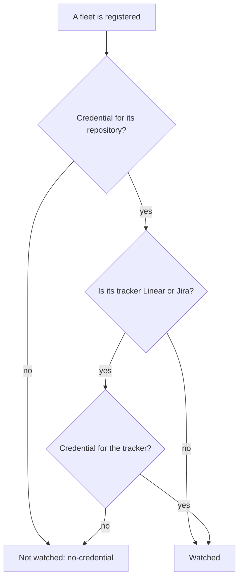

# Set the credentials for a fleet

Choose how Unattendish signs in to the forge and tracker of a fleet: a pasted token, your `gh` login or your `glab` login. A fleet with no Credential for its repository, or for its tracker where that is Linear or Jira, registers and is not watched, so do this before you rely on wakes. The entry format, the prefix rules and the default base URLs are [in the reference](../reference/unattendish-settings.md#credentials).



You need a bb server with the plugin installed, and the fleet's `<host>/<path>`, as its manifest's first line spells it.

## Choose the Credential for a prefix

| You want | `auth` | Needs |
|---|---|---|
| A token only this plugin uses, which you can revoke on its own | `token` | A token pasted under **Tokens** |
| GitHub reads made as your own `gh` login | `gh` | `gh auth login` done on the bb server as the user bb runs as |
| GitLab reads made as your own `glab` login | `glab` | `glab auth login` done on the bb server as the user bb runs as |

A `gh` or `glab` login is the account the fleet's agents act as, so the plugin's reads share their rate limit. `bb unattendish fleet status` says so for the fleet. Prefer a token of its own where the fleet is busy. You choose `gh` or `glab` per prefix, and the plugin never falls back to it, or to a token, when your choice fails.

## Use a pasted token

1. Create a token that can read the repository. For GitHub, GitHub documents that a fine-grained personal access token cannot call the Checks API, which the plugin needs to read a pull request's checks, so create a [personal access token (classic)](https://docs.github.com/en/authentication/keeping-your-account-and-data-secure/managing-your-personal-access-tokens). GitHub names the `repo` scope for reading check runs on a private repository ([Checks API](https://docs.github.com/en/rest/checks/runs)). For GitLab, a personal access token with the `read_api` scope, which GitLab describes as read access to the API ([token scopes](https://docs.gitlab.com/security/tokens/access_token_scopes/)). The plugin only reads, so grant nothing that writes.
2. Under Settings → Installed plugins → Unattendish, add an entry to **Credentials**. Its `prefix` is the host, the owner or group path or the repository:

   ```json
   [{"prefix": "github.com/org", "auth": "token"}]
   ```

3. Under **Tokens**, add the token for the same prefix:

   ```json
   {"github.com/org": "ghp_…"}
   ```

   **Tokens** is a secret setting: the page keeps its value out of sight, and no `bb unattendish` command shows or takes it.

Run `bb unattendish fleet status`. The fleet now lists `credential github.com/org (forge, github, token)`, and `watched` once its manifest can be read.

## Use my `gh` login or my `glab` login

Log in on the bb server, as the user bb runs as, then add the entry and no token:

```sh
gh auth login --hostname github.com
```

```json
[{"prefix": "github.com/org", "auth": "gh"}]
```

For GitLab, `glab auth login --hostname gitlab.com` and `{"prefix": "gitlab.com/group", "auth": "glab"}`. The plugin asks `gh auth token --hostname github.com` or `glab auth status --hostname gitlab.com --show-token` for the token when it polls, and ignores `GH_TOKEN`, `GITHUB_TOKEN`, `GITLAB_TOKEN` and the like in bb's environment, so the login you chose is what signs the request. If the CLI is not installed, not logged in to that host, or gives no token, the poll records a failed read and the fleet shows not watched with `no-credential`.

## Use Linear

Create a personal API key under Settings → Account → Security & access ([Linear's API docs](https://linear.app/docs/api-and-webhooks)). Linear lets a key be limited to chosen permissions: give it `Read` only. Add the entry for the fleet's Linear team, by its key, or for every team:

```json
[{"prefix": "linear:ENG", "auth": "token"}]
```

and `{"linear:ENG": "…"}` under **Tokens**. Register the fleet with `--tracker linear:ENG`. A Linear credential is separate from the forge's: the fleet needs one for its repository as well.

## Use Jira Cloud

Create an API token at [id.atlassian.com](https://id.atlassian.com/manage-profile/security/api-tokens) with **Create API token**, without scopes: a scoped token must call `api.atlassian.com`, and the plugin sends a Jira token only to your site ([Atlassian's token docs](https://support.atlassian.com/atlassian-account/docs/manage-api-tokens-for-your-atlassian-account/)). Atlassian expires a token after a year unless you choose a shorter time, and `bb unattendish fleet status` shows no expiry date for Jira. The token you paste is your account email, a colon and the token:

```json
[{"prefix": "jira:example.atlassian.net/PROJ", "auth": "token"}]
```

and `{"jira:example.atlassian.net/PROJ": "me@example.com:api-token"}` under **Tokens**. Register the fleet with `--tracker jira:example.atlassian.net/PROJ`.

## Use a self-managed GitLab or a GitHub Enterprise Server

Only `github.com` and `gitlab.com` name their service. For any other host, say which one in `service`:

```json
[
  {"prefix": "gitlab.example.com/platform", "auth": "token", "service": "gitlab"},
  {"prefix": "ghe.example.com", "auth": "gh", "service": "github"}
]
```

The API root is then `https://gitlab.example.com/api/v4` for GitLab and `https://ghe.example.com/api/v3` for GitHub Enterprise Server, which are where [GitLab](https://docs.gitlab.com/api/rest/) and [GitHub](https://docs.github.com/en/enterprise-server@3.14/rest/guides/getting-started-with-the-rest-api) put them. Add `baseUrl` only if yours differs, and only on the same host (or `api.` before it): the plugin refuses any other, so a token cannot be sent somewhere the prefix does not name. Register the fleet with `--repo gitlab.example.com/platform/app`.

## Give a repository its own Credential

A fleet uses the entry with the longest prefix that matches its repository, so one organisation-wide entry and one for a repository live together: `github.com/org/repo` wins over `github.com/org` for that repository. The tracker is matched on its own, so a fleet on GitHub with Linear issues uses one entry for `github.com/org/repo` and another for `linear:ENG`.

## Read why a fleet is not watched

`bb unattendish fleet status` prints `not watched:` and one `{code}: {text}` per reason. Registering prints the same reasons, and the fleet's manager is told once by a wake when a service refuses its credential.

| Code | Means | What to do |
|---|---|---|
| `manifest-missing` | The file at `--manifest` does not exist yet | Nothing: the manager writes it. Until then the fleet watches its labelled items |
| `manifest-unreadable` | The file exists, and cannot be read: it is over 1 MiB, not valid UTF-8, not `# Fleet: <host>/<path>` on its first line, or not a regular file | Fix the file; the text says which |
| `no-credential` | No entry matches the repository or the tracker, the entry was refused, or no token can be had | Add the entry the text names. If an entry exists, check **Tokens** has its prefix, and that `gh` or `glab` is logged in. A refused entry blocks shorter prefixes, so fix it rather than add another |
| `credential-refused` | The service refused the credential on the last poll; the fleet shows `not watched since {time}` | Create a new token, paste it in **Tokens**, and wait for the next poll |

Under the reasons, `unreadable manifest row` names a row the contract cannot read, with its section, line and why; the row is skipped and the rest of the manifest still counts. `outside the fleet, never fetched` names a reference or link in the manifest that lies outside the fleet's repository and tracker. `changes held since …` means the fleet's manager is archived, so nothing is sent until a thread registers the repository.

A setting the plugin cannot use is refused when you save it. One that came in another way is logged: `bb plugin logs unattendish-sdlc` shows each as a `settings:` warning.
