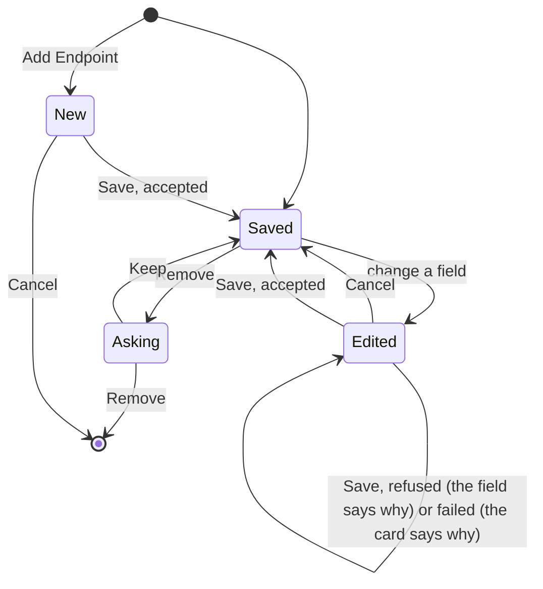

# OpenAI-compatible inference: Endpoints, the command and failures

Source: [`server.ts`](../../plugins/openai-inference/server.ts) for the services and the one-time copy, [`src/rules.ts`](../../plugins/openai-inference/src/rules.ts) for what Save accepts, [`src/manage.ts`](../../plugins/openai-inference/src/manage.ts) for what Save, Remove and the command do, [`features/endpoints-settings/`](../../plugins/openai-inference/features/endpoints-settings) for the section, [`src/cli.ts`](../../plugins/openai-inference/src/cli.ts) for the command, [`src/endpoints.ts`](../../plugins/openai-inference/src/endpoints.ts) for when an Endpoint is not ready, [`src/keys.ts`](../../plugins/openai-inference/src/keys.ts) for the literal keys, [`src/complete.ts`](../../plugins/openai-inference/src/complete.ts) and [`src/handlers.ts`](../../plugins/openai-inference/src/handlers.ts) for the failure messages.

## Endpoints

An **Endpoint** is an OpenAI-compatible server, a LiteLLM gateway or a local server alike, with an id, a base URL, the model it answers with and a key that may be none. The plugin keeps the Endpoints in its own storage, and you edit them in [its section in Settings](#the-endpoints-section) or with [its command](#the-command). Each Endpoint is one AI service with its Endpoint's id, offered for the `thread-title` and `commit-message` AI tasks and not for `voice`. To use two models on one server, list the server twice under two ids.

`bb settings ai-services` lists every Endpoint as `OpenAI-compatible endpoint at <url>`, with the url as saved, references unexpanded. bb refuses a name longer than 64 characters, so a long url is cut and ends in `…`.

Every Endpoint is listed, including one that cannot answer. That one is marked not ready, with the reason:

| Reason | Message |
|---|---|
| The Endpoint has no model, as one copied from a setting saved before 0.2.0 | The Endpoint needs a model: enter it in the Endpoints section of the plugin's page under Settings → Installed plugins → OpenAI-compatible inference. |
| The key is Literal and not set, as after the URL changed | The Endpoint's key is Literal and not set: enter it in the Endpoints section of the plugin's page under Settings → Installed plugins → OpenAI-compatible inference. |
| A `${NAME}` in the `url`, or in a Variable key, is unset or empty in bb's environment on the primary machine | Not set in bb's environment: followed by every such variable |
| bb has no primary machine, or the plugin's host entry on it cannot be called | No primary machine is connected, or the error of the failed call |

The messages of the first three rows appear together when more than one applies. Not ready is decided from the saved Endpoints and bb's environment alone: the server is never called to find out. A service that does not answer bb's status check within 2 seconds is marked not ready with `Not responding`.

### Selecting an Endpoint

Select an Endpoint for each AI task by its id:

```sh
bb settings ai-services set thread-title mlx
bb settings ai-services set commit-message gateway
bb settings ai-services test thread-title
```

The same choice is under Settings → AI services in the app. `test` runs a sample through the service now selected for a task.

- **Automatic never picks an Endpoint.** It chooses only among the services bb ships, so an Endpoint is used only after you select it.
- **bb has no fallback from one selected service to another.** When the selected service is not ready, or its request fails, bb does not try a second one, and the AI task is not done.
- **bb reads a service's status before every request.** It waits up to 2 seconds for the answer and keeps it for about 10, so a fix to a not ready Endpoint can take that long to show.

Every Endpoint is sent the same request; [how an AI task is sent](../explanation/openai-inference-requests.md) says what it holds.

## The Endpoints section

Under Settings → Installed plugins → OpenAI-compatible inference, the **Endpoints** section shows one card per Endpoint and **Add Endpoint**. Under its heading it says that each Endpoint is an AI service to select under Settings → AI services, and that a variable an Endpoint references needs a plugin reload to be seen after it changes. With no Endpoint it says "No Endpoint is set." and offers Add Endpoint. The plugin declares no setting once it has copied what 0.3 saved, so `bb plugin config` has nothing to show for it.



Each card has these fields, and Save refuses a card that breaks a rule, naming the field and changing nothing:

| Field | Rules |
|---|---|
| ID | Lowercase letters, digits and dashes, 2 to 64 characters, not `automatic` or `off`, which bb reserves, and not the ID of another Endpoint. Fixed once saved: bb selects a service for an AI task by its ID, so to rename, add an Endpoint, select it for the task and remove the old one |
| URL | An `http://` or `https://` URL ending where `/chat/completions` starts, or text holding `${NAME}` references, whole (`${GATEWAY_URL}`) or embedded (`https://${GATEWAY_HOST}/v1`). A trailing `/` is ignored |
| Model | Required: the name the server lists at `GET <url>/models`, sent as the request's `model` |
| Key | **None**; **Variable**, which takes only a `${NAME}` reference to bb's environment; or **Literal**, a masked field, which takes the key itself |

The key sent to an Endpoint, as `Authorization: Bearer <key>`, is the Variable's value or the literal key, and none for None.

Nothing applies until Save, and Cancel puts the card back as saved. A saved change applies at once, without a reload: Endpoints added are registered, Endpoints removed are unregistered, and the next request uses the new URL, model and key. A Save that fails for a reason other than a field, such as no primary machine being connected to keep a literal key, keeps what you typed and shows the error on the card. Leaving the page drops unsaved edits without asking.

**Add Endpoint** opens an empty card with an editable ID. Until it is first saved the card has Save and Cancel, which discards it without asking, and no Remove, and Add Endpoint is disabled.

**Remove** asks "Remove mac? If it's selected for an AI task, select another under Settings → AI services first, or that task stops." with Remove and Keep. The section cannot tell whether the Endpoint is selected, so it warns instead.

### Literal keys

A saved literal key is never shown: its card says "Key set", with **Replace**, which empties the field. Cancel keeps the saved key, and Save with Replace pressed and nothing typed keeps it too. The plugin deletes the key, leaving it in no file it keeps, when:

- Replace is saved with a new key, which takes its place;
- the Endpoint is saved with Key None or Variable;
- the Endpoint's **URL changes** and no key is typed with it: a key only reaches the server it was typed for, so the card then shows Literal, not set, and asks for the key again, and no AI task sends the old key to the new URL;
- the Endpoint is removed.

The key lives in `keys.json` in the plugin's data directory on the primary machine (`<data dir>/plugins/openai-inference/host-data/`), readable only by bb's user, and nowhere else: not in the plugin's storage on the server, not in what the page receives and not in the plugin's log. Saving one needs the primary machine connected.

## The command

`bb openai-inference` lists, sets and removes Endpoints. It takes no literal key, which goes in the section, and never shows one.

| Command | Does |
|---|---|
| `bb openai-inference list [--json]` | One line per Endpoint: its ID, URL, model and key, which is `none`, `variable NAME`, `literal (set)` or `literal (not set)` |
| `bb openai-inference set <id> --url <url> --model <model> [--key '${NAME}']` | Adds the Endpoint, or replaces the URL and model of the one with this ID, as a card's Save would, and refuses where Save refuses. The key changes only when `--key` is given, which takes only a `${NAME}` reference; leave it out to keep the Endpoint's key. For an Endpoint with a literal key it refuses a new URL and names the section, since a new URL clears the key |
| `bb openai-inference remove <id>` | Removes the Endpoint, and its literal key, without asking |

Put `--key`'s value in single quotes so the shell leaves `${...}` alone.

## Upgrading from 0.3

0.3 kept the Endpoints in the `endpoints` setting and literal keys in the secret `keys` setting. The first time a later release starts, it declares those two settings once more, copies the Endpoints and the keys into its own storage, unsets `keys`, records that it copied, and reloads itself, so bb stops drawing the two fields. `endpoints` is left as it was, so going back to 0.3 finds the Endpoints. An Endpoint stays selected for the AI tasks it was selected for, since its ID is the same.

- If an old value cannot be read, nothing is copied and neither setting is unset. The section says so, and you fix the setting in the field bb still draws and save it: the copy then runs again.
- If the primary machine cannot keep the keys, nothing is copied either; the section says so, and the plugin tries again every 30 seconds.
- An Endpoint saved before 0.2.0 with no `model` is copied with an empty Model, which its card asks for.
- The copy skips an ID the plugin already has, so running twice adds nothing.

## Environment variables

A `${NAME}` is expanded by the plugin's host entry, in bb's daemon on the primary machine, from that daemon's environment, for each request. `localhost` in a `url` means that machine. The expanded value is not stored or logged: the plugin's storage and files and bb's service list hold the reference, and failure messages carry the `${NAME}` in its place.

| Where the variable is set | Reaches the Endpoint | When a change applies |
|---|---|---|
| The environment bb was started with | Yes | When bb restarts |
| `bb machine env set NAME`, or Settings → Environment variables, global scope | Yes | After `bb plugin reload openai-inference`. Saving an Endpoint again is not enough: the host entry may keep its previous environment |
| `bb machine env set NAME --project <id>`, or a project's scope | No | bb passes project variables to agent turns and commands only |

## Failures

A request that fails rejects with a message that names the Endpoint by its id. bb reports it for the AI task after the service's name, as `OpenAI-compatible endpoint at <url>: <message>`. bb closes the request to the server when it gives up on it, which it does after 5 seconds for a thread title or a commit message.

| Message | When |
|---|---|
| `Endpoint "<id>" answered HTTP <status>: <detail>` | The server answered with a non-2xx status. `<detail>` is the server's own error message, cut to about 300 characters: 401 or 403 for a missing, wrong or expired key, 404 for a wrong URL, 429 for a rate limit, and 400 or 422 for an unknown model or, from LiteLLM, a spent budget |
| `Could not reach Endpoint "<id>": <reason>` | The connection failed |
| `Endpoint "<id>" answered with something that is not JSON.` | The answer is not a chat completion |
| `Endpoint "<id>" answered without message content.` | The completion has no message content, or it is empty |
| `Endpoint "<id>" broke off its answer: <reason>` | The connection closed before the answer was complete |
| `Endpoint "<id>" cannot answer: <reason>` | The Endpoint stopped being ready between bb's status read and the request, for the [reasons above](#endpoints) |

bb writes its own message when it gives up on a request: `OpenAI-compatible endpoint at <url> timed out after 5000ms` when the time limit passes, and `The request was cancelled` when the request is cancelled. It also writes `<service name> returned an empty reply` when nothing is left of the content once bb has taken out think blocks, quotes, labels and all but the first line, which is what a model that spends its 256 tokens thinking leaves. The plugin only closes the request.

No message holds a key or an expanded `${NAME}` value. A key, a variable's value and the host of one that is a URL are replaced by their `${NAME}`, and a literal key by `<key>`.

A 400 or 422 is first taken as the server refusing an optional field, and the request is sent again without it; the message is for the answer to the last request. [Fields a server refuses](../explanation/openai-inference-requests.md#fields-a-server-refuses) says which fields.

## What stays after uninstalling

`bb plugin uninstall openai-inference` deletes the plugin's settings, and nothing else it keeps: the Endpoints stay in the plugin's key-value store on the server, so a reinstall finds them, and the host entry's files stay in `plugins/openai-inference/host-data/`, in the data directory of bb on the primary machine (`~/.bb` by default), readable only by bb's user. To delete the literal keys, remove the Endpoints that hold them before uninstalling, or delete that folder after:

| File | Holds |
|---|---|
| `keys.json` | The literal keys of the Endpoints, by Endpoint ID |
| `learned-fields.json` | The [fields each Endpoint URL and model refused](../explanation/openai-inference-requests.md#why-what-was-dropped-is-kept-in-a-file). No keys: URLs as the Endpoints hold them, model names and field names |

Delete that folder after uninstalling to leave no key and nothing learned on the machine.
