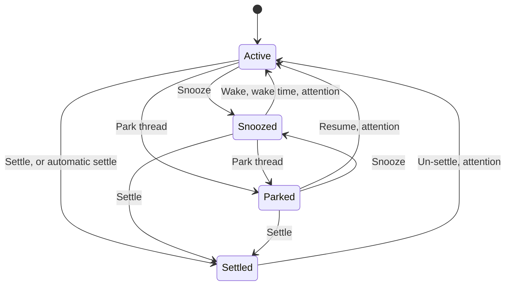

# Thread Glance: actions, menus and reordering

What each action does, where it is offered, and what the keyboard and the pointer reach. Why the lifecycle has these three verbs is in [why the list keeps threads on shelves](../explanation/thread-glance-shelves.md); the shelves and rows are in [the list](thread-glance-list.md). Sources: [`shared/contract.ts`](../../plugins/thread-glance/shared/contract.ts) for the actions the server answers, [`shared/snooze.ts`](../../plugins/thread-glance/shared/snooze.ts) for presets, [`features/thread-list/commands/`](../../plugins/thread-glance/features/thread-list/commands/) for what a click does and [`model/reorder.ts`](../../plugins/thread-glance/features/thread-list/model/reorder.ts) for reordering.

Snooze, Park and Settle are offered only for a thread that is not [busy](thread-glance-list.md#busy-threads), and the server checks again when the action arrives: it refuses a busy thread, so a thread that started a turn after its menu opened changes nothing and shows the error.

## Snooze

Offered from the card's clock button and from the [thread menu](#thread-menu), wherever the thread is not busy and not [woke](thread-glance-list.md#woke). On Parked and Settled, from the slim row's thread menu. It lists the snooze presets, then **Pick date & time…**.

Snoozing unpins the thread, records the wake time and the snooze time, and [reclaims](#reclaim) the thread. The toast reads "Thread snoozed" and "Wakes <date, time>", plus what was reclaimed, and has **Undo**; it lasts 10 s when there is a reclaim note. The server refuses a snooze time in the past or more than a year ahead.

### Snooze presets

The **Snooze shortcuts** setting is a comma-separated list of at most 8 entries and 500 characters. Each entry is an optional `Label=` prefix (up to 40 characters) followed by one of:

| Entry | Means | Label when none is given |
|---|---|---|
| A duration: `30m`, `1.5h`, `2d`, `1w` | That long from now, from 1 minute to 365 days | "N minute(s)", "hour(s)", "day(s)" or "week(s)" |
| `evening`, optionally `@HH:MM` | Today at that time, 18:00 if none | This evening |
| `tomorrow`, optionally `@HH:MM` | Tomorrow at that time, 09:00 if none | Tomorrow morning |
| `next-week`, optionally `@HH:MM` | The next Monday strictly after today at that time, 09:00 if none | Next week |

The default is `1h, Wait refresh (5 hours)=5h, evening@18:00, tomorrow@09:00, next-week@09:00`.

A preset whose time has already passed today is disabled with "Today's time has passed": as a tooltip in the card's clock menu, and as the footnote of the **Snooze ▸** list in bb's thread menu. Saving the setting rejects any invalid entry and shows the reason. When reading it, Thread Glance drops invalid entries and uses the defaults only if none remain.

### Pick date & time…

Opens **Snooze until**: a Monday-first calendar (days before today and days after a year disabled), a time field, and a preview such as "Wakes Sun, Oct 4, 9:00 AM", with the year shown only when it is not this year. It starts on tomorrow at 09:00. These disable **Snooze**:

| Message | When |
|---|---|
| "Enter a time." | The time field is empty |
| "Pick a time in the future." | The moment is not ahead |
| "Snooze for at most a year." | The moment is more than a year ahead |

The dialog re-reads the clock every 15 s while it is open.

### Waking

The Snoozed shelf sorts by soonest wake. **Wake**, the Snoozed slim row's button (**Wake now** in the thread menu), clears the snooze and toasts "Thread woke up" with **Undo**; Undo snoozes the thread again only while its old wake time is still ahead. A thread otherwise wakes at its time or on [attention](../../plugins/thread-glance/GLOSSARY.md) and is then [woke](thread-glance-list.md#woke).

## Park

**Park thread**, in the thread menu and the clock menu. It unpins the thread, records the park time and reclaims. The toast reads "Thread parked", with **Undo** (resume).

**Resume**, the Parked slim row's button and the thread menu's item, returns the thread to Active and toasts "Thread returned to Active", with **Undo** (park). Attention also returns a parked thread to Active.

## Settle

**Settle**, on the card's hover actions and in the thread menu, including the slim rows of Parked and Snoozed.

1. Unless reduced motion is on, a 520 ms sweep plays across the thread's card whenever the card is drawn; otherwise the thread settles at once.
2. The settle covers the whole thread tree under the thread. If any thread in it is busy, it fails with "Cannot settle while <title> is working or waiting for input".
3. It unpins the tree's pinned threads and marks every thread in the tree settled. If the tree changed meanwhile, it fails with "Thread tree changed while settling. Try again." and restores any pins it removed.
4. Each thread is [reclaimed](#reclaim).

The toast reads "Thread settled", plus what was reclaimed, with **Undo**, for 4 s, or 10 s with a reclaim note. A settle of a thread that owns ports then asks to [close them](#close-a-settled-threads-ports). The server keeps the settle's snapshot in memory until Undo can no longer be pressed. **Undo** restores each thread's previous shelf where nothing changed since and toasts "Settling undone". If the snapshot is gone, as after a plugin restart, the toast reads "This Settle can no longer be undone. Use Un-settle instead."

**Un-settle**, the Settled slim row's button and the thread menu's item, returns the thread to Active, returns its settled descendants to the automatic rules and reopens its ancestors. The toast reads "Thread returned to Active", with **Undo** (settle).

[Automatic settle](../explanation/thread-glance-shelves.md#automatic-settle) uses the same marks without a toast.

## Reclaim

After a park, snooze or settle, and only while the thread is still unpinned, not busy and unchanged, Thread Glance:

- stops the thread's agent runtime;
- closes the thread's terminals that are running but have never had input, leaving the rest.

The note joins "Agent session stopped", "closed N terminals nobody used" and "N terminals left running" with " · ", for example "Agent session stopped · closed 1 terminal nobody used · 1 terminal left running". It is shown in the toast.

When a thread is archived from any bb menu, its runtime and its idle children's runtimes are stopped; a working child is left alone. When a child thread is created or starts a turn, its parked, snoozed or settled ancestors are reopened to Active.

## Ports

Every way of closing a port sends SIGTERM only to a process the server's snapshot lists in the thread's environment, after its machine reads the port again and finds the same PID and the same start time, so a reused PID is never signalled. Anything else is refused and nothing is signalled. [Workspace ports](thread-glance-list.md#workspace-ports) says what is listed.

### Stop a port

**Stop**, beside a listener with a process in the hover card. The first press turns it into **Confirm stop**, which lapses after 4 s; the second sends the request and the list reads the ports again. A Docker-only port has no Stop.

### Close a settled thread's ports

After a manual settle of a thread that owns ports, a toast stays until dismissed: "Close this thread's ports?", "Stop the processes listening on :p1, :p2? This also closes any other ports those processes serve.", with **Keep open** and **Close ports**. Any later action on the thread dismisses it, and so does the thread leaving Settled.

**Close ports** signals only while the thread is still settled, and toasts one of:

| Toast | When |
|---|---|
| "Stop requested for port processes", "Processes received a graceful shutdown request. Ports may take a moment to close." | Every matching process got the request |
| "Some port processes could not be stopped" | Some could not |
| "No matching thread-owned ports are still running" | None still matches, or the thread is no longer settled |
| "Could not close thread ports" | The call failed |

If the ports cannot be looked up after the settle, the toast reads "Thread settled, but its ports could not be checked".

[Automatic settle](../explanation/thread-glance-shelves.md#automatic-settle) holds back, for that pass, a thread that serves a port: one it owns, or an unowned port in an environment where it is the only thread. A machine that cannot be scanned holds back all of its threads.

### Clean settled resources

**Clean**, a broom icon on the Settled shelf's header even while it is collapsed, is labelled "Close terminals and ports of settled threads", with the tooltip "Close terminals and ports of settled threads (threads stay in Settled)". It opens **Clean settled resources?**, a preview of the settled threads in the list's project scope:

- A thread is included when it is still settled, not hidden, unpinned, not busy and has had no attention since it settled. A thread sharing a workspace with any thread that fails that test, or whose workspace cannot be resolved, is left out without a word.
- Each included thread lists its running or starting terminals, typed into or not, and its owned ports, with **Open**, which opens the thread and closes the dialog.
- The dialog warns "This closes terminals even if you typed into them." and "A port process may need time to exit after its shutdown request." With nothing to close it reads "No live terminals or thread-owned listening ports found."

**Clean resources** ("Cleaning..." while it runs) checks each thread and workspace again before each terminal and port, force-closes each terminal, sends SIGTERM to each port, waits 750 ms and reports "N terminals closed · M port shutdown requests sent" (each noun singular for one) or "No resources were closed.", then "Still listening after the request: :port" and any issue, naming threads by title. No thread leaves Settled.

The preview lasts 2 minutes, survives a plugin restart, and runs once. A used or expired one reads "Cleanup preview expired. Review the resources again.", with **Refresh preview**.

Unlike [Reclaim](#reclaim), which closes only terminals nobody typed into, Clean closes every running terminal: you asked for it, after seeing the list.

## Thread menu

Thread Glance adds its actions to bb's thread menu, which appears on a row's **…** and right-click, in the thread header and in the compact long-press drawer. Each action sits in bb's menu groups as close to this order as they allow:

| Where | Action | Offered |
|---|---|---|
| After bb's Open in split | **Parent…** | Always |
| | **Project ▸** | For a non-personal project |
| After bb's Pin | **Snooze ▸** (presets, then Pick date & time…) | The thread is not busy and not woke |
| | **Wake now** | The thread is snoozed |
| | **Park thread** | The thread is not busy |
| | **Resume** | The thread is parked |
| | **Settle** | The thread is not busy |
| | **Un-settle** | The thread is settled |
| Beside bb's Copy thread link | **Copy branch** | The thread has a branch |
| | **Copy thread ID** | Always |

bb's own Rename, Mark read or unread, Archive and Delete keep their places. Delete is bb's, which confirms child threads.

Parent…, **Project ▸** and **Pick date & time…** open dialogs that Thread Glance mounts in bb's app overlay. A bb without that slot keeps the menu entries, and choosing one toasts "This action needs bb's app overlay, which this version of bb does not offer."

### Parent…

Opens a search dialog.

- The first option is **None**, always shown.
- The candidates are every non-archived thread except the thread itself and its descendants, plus the current parent even if archived. Same-project threads come first, then by recent activity. Other-project threads read "Project · Title". The current parent is checked.
- A thread that sits below the thread, even through an archived thread, is refused with "That thread sits below this one, so it can't be its parent."
- Choosing a parent unpins a pinned thread, with a note saying so. **None** keeps the pin.

Toasts read "Parent updated", "Parent removed" or "Parent updated, but unpinning could not be confirmed".

### Project ▸

| Item | Does |
|---|---|
| **Project settings** | Opens bb's page for the project |
| **Rename project** | Renames it; up to 500 characters |
| **Add local path** | A machine picker and a folder up to 4,096 characters. Hidden without machines, and disabled with "Could not load machines"; the machines are listed again every 30 s while there are none or listing failed |
| **Remove project** | Needs the project's exact name typed, and removes its colour and icon too |

## Thread header buttons

| Button | Shows | Opens |
|---|---|---|
| Parent button | "Back to parent: <title>", with a left chevron and the parent's mark. The title is dropped on a compact viewport | The parent thread |
| Children button | "Needs you" if a direct child needs you, else "N child/children", plus up to three marks. The label is dropped on a compact viewport | A 320 px popover listing the children. It closes when the thread changes or the last child goes away |

## Active sort

Active's header has a sort select. It is saved on the device and highlighted when it is not Manual order.

| Sort | Does | Reordering Active |
|---|---|---|
| **Manual order** (default) | One list stored on the server of every non-hidden, non-archived, non-pinned thread across all projects and shelves. New threads go to the top | On |
| **Recent activity** | Changes only what is shown, never the stored order | Off |
| **Date created** | As Recent activity | Off |
| **Project** | Groups Active by project, keeping manual order inside and between groups | On, among the group |

Working and Inactive keep Active's manual order, so a returning thread lands in its old slot. Pinned can be reordered in every sort.

In **Project** mode a project with at least two Active threads gets a header, and other projects' threads stay as lone rows. The header shows the project's icon, its name in the project colour, its count and a chevron. A group sits where its first thread sits, and moving the header moves the group. Collapsing a group is saved on the device, and a collapsed group keeps the open thread and any thread that needs attention. Cards inside a group hide their project line.

With **Group by worktree** on, the Project sort goes one level further. Root threads of a project group that run in the same bb worktree, two or more, sit together under a worktree header one step in, named by its branch and showing its count and a chevron. A thread alone in its worktree, a thread in the project's own checkout and a child thread show as they do without the setting. A worktree group sits where its first thread sits in its project, and moving its header moves its threads in the manual order, while dragging a thread inside it moves only that group's threads. Collapsing it is saved on the device and keeps only the open thread; while collapsed, its header shows the mark of the most urgent state in its threads and below them, as the [children chip](thread-glance-list.md#children-chip) does. The setting is in the [settings](thread-glance-settings.md#sidebar-layout) and, while the sort is Project, on Active's header, and it applies to every window.

## Reordering

| | Pointer | Keyboard |
|---|---|---|
| Start | Left button only, not touch. The pointer moves at least 6 px, more vertically than sideways, since sideways is left to bb's drag-to-split | **Alt+Arrow Up** or **Alt+Arrow Down** on a row |
| Move | The row moves as soon as the pointer enters the next row, in the direction of travel. Over empty space it moves to the first or last slot | One slot |
| Feedback | The list auto-scrolls within 48 px of an edge, up to 14 px a frame. Other rows slide over 150 ms, not under reduced motion | Announces "<title> moved to N of M in Active" (or "in Pinned"), or that the row is already first or last |

- Escape, losing focus, resizing, hiding the page, a hidden tab or a cancelled pointer abandons the drag without writing. The click after a drag is swallowed once.
- A thread inside a group moves only among that group. A thread deleted mid-drag cancels the drag.
- Writes are optimistic. A failure rolls back and toasts "Could not reorder Active thread". Pinned order is bb's pin order; a failure toasts "Could not reorder pinned thread".
