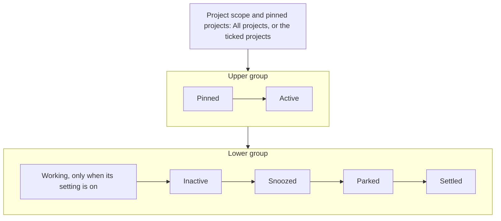
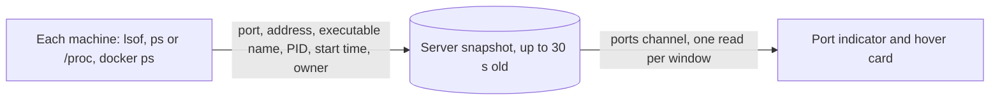

# Thread Glance: the list, its shelves and rows

The list is a [project scope](#project-scope) and then a column of [shelves](#shelves). Which shelf a thread sits on follows its [lifecycle row](#which-shelf-a-thread-is-on); what a row draws depends on the shelf. The settings that change the list are in [settings](thread-glance-settings.md), the actions on a row in [actions](thread-glance-actions.md), and [why the list keeps threads on shelves](../explanation/thread-glance-shelves.md) is its own page. Sources: [`shared/lifecycle.ts`](../../plugins/thread-glance/shared/lifecycle.ts) for the shelf rules, [`shared/busy.ts`](../../plugins/thread-glance/shared/busy.ts) for the busy rule and [`features/thread-list/model/list-model.ts`](../../plugins/thread-glance/features/thread-list/model/list-model.ts) for what the list draws.

## Project scope

The picker at the top of the list. **All projects** shows every shelf as it is; ticking projects limits every shelf to those projects.

- It lists every project, the personal one included, with a filter field. A project ticks and unticks when clicked, or with Enter on the highlighted option, and the list follows at once; **Done** closes the picker. **All projects** clears the ticks. The arrow keys move through the options and wrap, and Home and End jump to the first and last.
- Each project's row also has a pin button, labelled "Pin <project>" or "Unpin <project>", which sets the project among the [pinned projects](#pinned-projects) without ticking it. **All projects** has none.
- The scope applies to every shelf and to Clean. It does not limit thread search, which is bb's palette.
- It is saved per window, in the browser's session storage: a reload keeps it, another window has its own, and a new window starts on All projects. A project that bb no longer lists drops out of the scope once bb has listed the projects, and a scope with no project left is All projects.
- A project the scope leaves out that has a thread waiting on a question or an approval puts a **Needs you** mark on the picker's button, whose name then ends "Needs you in <projects>", and on its own row in the picker. The mark goes when the thread is answered.

### Pinned projects

A project pinned from the picker is drawn as its [project mark](thread-glance-settings.md#project-appearance) in a row of icons under the picker's button, in the order the projects were pinned. The row is drawn while a project is pinned or the scope limits the list.

- Clicking a pin puts its project in the scope when it is out, and takes it out when it is in, exactly as ticking it in the picker does: a scope that is left empty is All projects. A pin in the scope is pressed, and a pin the scope leaves out that has a thread waiting on a question or an approval carries the **Needs you** mark, its name ending ". Needs you".
- **Reset**, an icon with no text at the end of the row and drawn only while the scope limits the list, makes the scope All projects. It leaves the pins.
- Pins are saved per device, in the browser's `localStorage`, up to 50, and a change in one window reaches the others on the device at once. A pin whose project bb no longer lists is not drawn and is kept, in case the project returns.

## Shelves

| Shelf | Icon | Open by default | Row | Sorted by |
|---|---|---|---|---|
| Pinned | `Pin` | Yes | [Full card](#full-card) | bb's pin order, which you can change by [reordering](thread-glance-actions.md#reordering) |
| Active | `Pulse` | Yes | Full card | The [Active sort](thread-glance-actions.md#active-sort), manual order by default |
| Working | `Loading`, spinning while the shelf has work, even under reduced motion | Yes | [Folded card](#folded-card) | Active's manual order |
| Inactive | `PauseCircle` | No | Full card | Active's manual order |
| Snoozed | `Clock` | No | [Slim row](#slim-row) | Soonest wake first |
| Parked | `Car` | No | Slim row | Newest park first |
| Settled | `Meditation` | No | Slim row | Newest settle first: 10 shown, then **Load N more** in pages of 25 |

- **Upper group** is Pinned, then Active. **Lower group** is Working (only with the **Working shelf** setting on), Inactive, Snoozed, Parked and Settled. With **Dock shelves to the bottom** on, the lower group sits at the bottom of the sidebar's viewport.
- A shelf header shows its icon and name, "Name (count)" while the shelf is collapsed, then a chevron and a faint rule running to its controls (Active's sort, Settled's Clean) or to its right edge. A click anywhere from the icon to the end of the rule opens or closes the shelf, and the rule shrinks away before the name truncates. A shelf with no threads is not drawn.
- Collapsing is per shelf and saved on the device. A collapsed shelf still shows the open thread and, with **Show children that need attention** on, any thread whose tree needs you or failed.
- The scroller has no scrollbar, and its edges fade by up to 12 px.

### While loading, and when empty

| Shown | When |
|---|---|
| "Loading threads…" with a spinner | The list has been loading for 200 ms. Its live region exists from the start |
| "Could not load threads." | Loading failed |
| **All clear** scene: "All clear. Time to touch some grass." and a small outline illustration | No pinned, Active, Working or Inactive thread is visible |
| **Working scene**: an animated outline typist and one of 18 lines | The Working shelf is on and every visible thread is on it. The line is drawn when the scene mounts and the next draw never repeats the previous one; the animation runs only without reduced motion |

## Which shelf a thread is on

Archived threads appear nowhere.

A child thread whose parent is visible in the current scope is not a row of its own: it appears under its parent's card, behind the [children chip](#children-chip). A child whose parent is archived, in another project or outside the scope is an ordinary row. A pinned child is a row of its own on Pinned and leaves its parent's chip and child list while it is pinned.

The server keeps a [lifecycle row](../../plugins/thread-glance/GLOSSARY.md) per thread. The shelf is the first of these that applies:

| # | Rule | Shelf |
|---|---|---|
| 1 | The thread is pinned | Pinned |
| 2 | The thread has no lifecycle row | Active |
| 3 | The thread is [busy](#busy-threads), or [lifted](#lifted-threads) | Active |
| 4 | The thread is parked, and no attention arrived after the park | Parked |
| 5 | The thread is snoozed, and has not woken | Snoozed |
| 6 | The thread is settled, and no attention arrived after the settle | Settled |
| 7 | Otherwise | Active |

Attention that arrives after a park or a settle brings the thread back to Active and clears the park or settle mark, except attention set aside while a question waited below the thread (see [lifted threads](#lifted-threads)). A snooze ends at its wake time or on attention, and the thread is then [woke](#woke).

Pin is bb's own action, so a window that sees a pinned thread with a lifecycle row asks the server to clear the row, and unpinning returns the thread to Active under these rules.

Of the threads left on Active:

| Setting | Moves a thread to | When |
|---|---|---|
| **Working shelf** on | Working | Its tree is working, it is not woke or lifted and it does not need you |
| **Inactive shelf** on | Inactive | It is not busy, it does not need you, it is not woke or lifted, and its latest activity (the latest of created, updated and attention) is **Hours before inactive** ago or more |

A row being renamed keeps its shelf until the rename ends.

### Busy threads

One rule decides busy for the buttons, the server's checks, automatic settling and Reclaim. A thread is busy while any of these holds:

- a question or approval is pending;
- a queued message waits, or one failed;
- a turn is in flight (starting, active or stopping; a thread bb lists as pending, created and never run, has none);
- any activity counter is above zero: workflows, background agents, background commands, plan mode, goals;
- its runtime is starting, active or provisioning (the runtime's display status), which includes a runtime kept alive between turns by a running monitor.

A busy thread offers no Snooze, Park or Settle, and the server refuses all three.

A never-run thread with nothing queued is at rest, as bb's own list draws it: it can be snoozed, parked and settled, and auto-settle settles it once it has been quiet long enough. One whose first message waits to send, scheduled for later or not, is busy through that queued message but not working: it sits on Active with its Queued status, no spinner, and is left out of the Working shelf, the children chip's working count and Compact working threads.

### Lifted threads

A thread is lifted while a question or approval is pending on any thread below it, at any depth. A parked, snoozed or settled thread that is lifted is on Active, and a snoozed one shows as [woke](#woke). The lift changes none of the row's marks, and while the question waits the mark is held: turns in the thread's tree, including the turns bb's parent notifications start when a child asks, neither reopen the thread nor count as attention against its park, snooze or settle. Once no such question waits, whether it was answered or its thread was archived, deleted or interrupted, the thread returns to its shelf: a parked thread keeps its park time, a settled one stays settled, and a snoozed one returns to Snoozed with its wake time, unless that time has passed meanwhile, when it stays woke.

The hold ends with the question, except for a turn that began while it waited: such a turn's end is held too, though the answer came first, until the plugin restarts. A turn that starts after the answer reopens the thread's ancestors and attention after it clears the mark, as at any other time; so with bb's parent notifications on, a child that finishes its turn after the answer notifies its parents, and that turn clears the mark. The attention set aside is kept in the row (`heldAttentionAt`, the latest of it) so that it survives a restart. The hold does not apply to a thread whose own question is pending: that question is its own attention.

Park, Snooze and Settle on a lifted thread are refused, in the window at once and by the server, with "Cannot <action> while a child thread needs you: <title>", naming the thread that asks. A thread's own question is not a lift: it makes the thread [busy](#busy-threads), and new attention takes it off Parked and Settled as usual. Hidden threads and archived ones are not counted, and a thread that is not on the list ends the chain above it.

### Woke

A snoozed thread wakes at its wake time or when attention arrives after the snooze. It is then on Active, in bold, with a **Woke** label and a **Dismiss Woke marker** button. Opening the thread, or dismissing the label, clears the marker. The marker is the same in every window and survives reloads. A woke thread offers no Snooze, and is never moved to Working or Inactive.

A snoozed thread that is [lifted](#lifted-threads) and has not otherwise woken shows the same label, without the dismiss button: it leaves no marker to clear, since it returns to Snoozed when the question is gone.

## Cards and rows

| Row | Lines | Used on |
|---|---|---|
| [Full card](#full-card) | 3 | Pinned, Active, Inactive, and a working thread unless it is folded |
| [Folded card](#folded-card) | 1 | Working, and working threads while **Compact working threads** is on |
| [Slim row](#slim-row) | 1, 32 px | Snoozed, Parked, Settled |

Heights are kept in one place, [`model/heights.ts`](../../plugins/thread-glance/features/thread-list/model/heights.ts).

### Full card

- Line 1: the project's icon and name, then the [status slot](#status-slot).
- Line 2: the title.
- Line 3: the branch, or the worktree branch, or the machine when there is no branch; then the [children chip](#children-chip); then a machine icon when both a branch and a machine exist; workflow and background-agent counts; the [pull request badge](#pull-request-badge); the [port indicator](#workspace-ports) while something listens in the thread's workspace; and the harness logo, always.

### Folded card

One line: project name · title, then the children chip, the [port indicator](#workspace-ports), an unpin button and the live status with elapsed time or the age. It unfolds to a full card when the work ends, fails or needs you.

### Slim row

One line: project name · title, the [children chip](#children-chip) on a parent, and the shelf's label, with a button to restore the thread. The button shows on hover, always on touch; a screen reader hears it as "Resume thread", "Wake thread now" or "Un-settle thread". On a narrow row the project name gives way first, then the label or status, then the title down to 48 px, so the chip and the restore button stay whole at bb's default sidebar width; below about 200 px the row keeps nothing whole and never scrolls sideways. While a jump hint shows, its key keeps its width: the title has no floor and the hover buttons hide; where one holds keyboard focus the buttons stay and the hint hides instead. The thread's other actions are in the [thread menu](thread-glance-actions.md#thread-menu).

| Shelf | Label | Restore button |
|---|---|---|
| Parked | "Waiting Nd" | **Resume** |
| Snoozed | The wake time ("now", "Nm", "Nh" or "Nd", rounded up) | **Wake** |
| Settled | The status slot's status, or the age | **Un-settle** |

### Stripe, colour and icon

With **Project colors** on, a 2 px stripe at a row's left edge shows the project colour, following **Show stripes in**. [Project colours and icons](thread-glance-settings.md#project-colours-and-icons) says how the colour, the icon and the monogram are chosen.

### On any row

- On hover, a card that is not busy and not woke shows **Snooze** and **Settle** in the status slot.
- Unread titles are bold; read idle titles are muted.
- The open thread's row is highlighted, and a row open in another pane is tinted.
- The **Unpin** button shows on hover, always on touch.
- Double-click renames inline. The field holds the stored title, [mentions](#titles-with-mentions) as typed. It keeps focus until you leave it, however long bb takes to open the thread; leaving is a click outside it or Tab, and switching to another window is not. Enter or leaving the field saves a trimmed, changed title; Escape cancels.
- Inside a project group on Active, a card hides its project line ([Project sort](thread-glance-actions.md#active-sort)).

### Titles with mentions

A title can mention a project, a section or a thread (`@project:`, `@section:` and `@thread:`). Wherever Thread Glance shows a title, it draws bb's resolved name with bb's mention chip, as bb's own lists do: on rows, in the child lists and the [hover card](#hover-card), in the thread header's Parent and Children buttons, in the Snooze and Parent dialogs, in the Clean dialog, and in the toast that refuses Park, Snooze or Settle on a thread. Text that is only read aloud or announced, such as a button's name and the reorder announcement, uses the same name as plain text. File mentions are not drawn as chips.

A thread that bb no longer lists has no name to resolve: an archived current parent in the Parent dialog, or a thread in the Clean dialog that was archived since the preview, shows its title as stored. A refusal that the server sends after the window's own check, because the thread changed in between, also names the thread by its title as stored.

### Pull request badge

`#number` comes from bb's bundled GitHub PR Status plugin for the thread's environment. Its colour follows the pull request's attention state, as the [hover card](#hover-card) colours its label. No badge shows while no status can be had: no pull request, a lookup that failed, GitHub PR Status disabled or not installed. Its tooltip is the pull request's title and label, and it opens the pull request in a new tab.

## Status slot

The 80 px, right-aligned slot shows one thing, the first that applies:

1. "Needs you" while a question or approval is pending.
2. "Send failed" or "Queued" for the queued message.
3. The indicator's label: Failed, Needs you, Unread, Working or Monitoring, Workflow, Agent, Command, Planning, Goal, Draft or Drafting.
4. Otherwise the age: "now", "Nm", "Nh", "Nd" up to 7 days, then "Nw", refreshed every minute.

Working-type labels add " · 5m" from when the thread was first seen working. That stamp survives reloads, and a fresh one starts after a pause.

| Label | Glyph | Colour |
|---|---|---|
| Failed | Circle with a cross | Red |
| Needs you | Question mark | Amber |
| Working | Spinner | Sky |
| Workflow, Agent, Command, Monitoring, Planning, Goal | A shining icon | Sky |
| Draft, Drafting | Pencil | Amber |
| Unread | Dot | Emerald |

Colours follow bb's theme, light or dark, not the operating system's.

## Children chip

On a parent's card, whether a full card, a folded card or a slim row on Snoozed, Parked or Settled:

- the number of its direct, non-archived children;
- up to three child marks;
- the most urgent glyph in the whole subtree: failed, then needs you, then done, then working;
- a chevron.

Its tooltip reads "N child threads, 1 failed, 2 need you…".

Opening the chip lists the children under the card. Which parents are open is saved on the device (the last 100 parents), so a tree opened on Settled is still open when the list loads again. Settling a thread closes the child lists of its whole tree; the lists stay closed until you open them again. A closed list still shows the path to the open thread and, with **Show children that need attention** on, children with a status.

Child rows have their own marks, titles and status or age, and a disclosure for their own children, named "Grandchildren", "Great-grandchildren" and "Descendants". A child from another project carries its project icon. Children sort and are marked by the [Child threads settings](thread-glance-settings.md#child-threads).

## Hover card

Opens 250 ms after the pointer rests on a row, never on touch, and closes 300 ms after the pointer leaves. Keyboard focus opens it at once. One card is open at a time, on the right of the row, 256 px wide. It shows:

- the title, project, machine and branch;
- the harness with its status glyph, then the model and reasoning level on one line as bb names them, such as "GPT 6.1 Sol Medium", loaded from bb. A model bb has no display name for shows its id; a level takes the label bb's model list gives it, else the level capitalised; no level leaves the name alone; "Loading…", "Not set" or "Unavailable" stand in for what is missing;
- the branch's pull request from GitHub PR Status, when it has one: `#number` and title, linking to it, with its attention state as its label and its checks, review and mergeability on one line. No pull request, no section;
- "Subthreads (N)", with a toggle listing the direct children, each opening that child;
- "Workspace ports (N)", when the thread's environment has listeners ([Workspace ports](#workspace-ports)).

| Pull request label | Colour |
|---|---|
| Merged | Violet |
| Blocked, Changes requested, Checks failed, Conflicts, Closed | Red |
| Open (when GitHub PR Status reports no attention state) | Emerald |
| Draft, Checks pending, Ready to merge, In merge queue, Review requested | Muted |

## Workspace ports

A machine bb runs threads on, macOS or Linux, reports every listening TCP socket whose process works inside a thread's workspace. A Windows machine reports none, and its threads show no indicator.

- A listener belongs to the workspace that is the longest match for its process's working directory. Several environments on one path all show it. bb's own listeners are left out.
- A port is the thread's [owned port](../../plugins/thread-glance/GLOSSARY.md) when its process's environment holds a single `BB_THREAD_ID` naming that thread, and the thread works in that environment. Only that one entry is read: nothing else of a process's environment or command line leaves its machine. Every other port belongs to the workspace only.
- A Docker container whose compose working directory is inside a workspace adds its published ports, with no owner and nothing to stop.
- The **port indicator**, a plug on the full card's third line and on the folded card, shows while the environment has listeners; its accessible name counts them. Slim rows have none.
- The hover card's "Workspace ports (N)" lists each listener's port and executable name, or its container, scrolling beyond 4. A listener with a process has **Stop** ([Stop a port](thread-glance-actions.md#stop-a-port)).
- With a [port link machine](thread-glance-settings.md#this-device) chosen, the ports of that machine bound to a loopback or wildcard address are links: `https` for 443 and 8443, else `http`, to `127.0.0.1`, or `[::1]` for a port bound to `::1` only.
- Touch has the indicator only, since the hover card opens on pointer hover and keyboard focus.

The server rereads every non-archived thread's environment at most every 30 s, and each visible window asks again 10 s after its last read completed, and at once when its tab is shown again. A machine whose scan fails is left out, and asked again after 30 s, doubling up to 5 minutes. A read that fails everywhere keeps the last snapshot for up to 5 minutes, so the indicators stay.

## Jump hints

While bb's jump modifier is held, each row bb gives a jump key shows bb's own label for it in the status slot, such as "Ctrl + Shift + 1" on the web, where holding Ctrl shows them. bb decides when the hints show, which rows get them and the chord each names, and performs the jump: it numbers the first nine rows the list has drawn, in page order, so with the upper list holding fewer than nine, the keys reach on into the lower one. The list draws only the rows near the view, and always the upper list's first nine, so after scrolling, numbered rows can be out of view and rows in view can have no number. The slot widens while a hint is longer than it.
