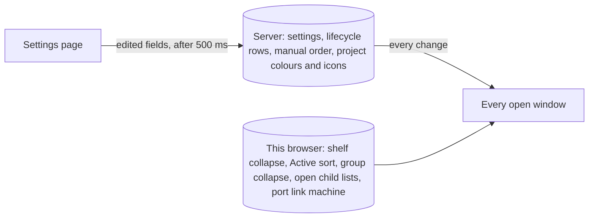

# Thread Glance: settings and what it stores

Thread Glance's settings are one validated record on the bb server, edited on its settings page and followed by every window and device. A few choices are kept in the browser instead, and stay on that device. Source: [`shared/settings.ts`](../../plugins/thread-glance/shared/settings.ts).

## The settings page

The settings live in a bb settings section with a navigation strip and six groups, below.

- Every change saves by itself after 500 ms, and only the edited fields are sent.
- The page heading shows "Saving…", then "Saved" for 2 s, or "Not saved" with the toast "Could not save sidebar settings".
- A value outside its range shows an inline error and is not saved; the other edited fields still are.
- A pending save is flushed when you leave the page.
- A change made in another window reloads the page without overwriting a field you are editing.
- A fresh browser shows the defaults, so Inactive is on, until the server's settings arrive.

### Sidebar layout

| Setting | Default | Does |
|---|---|---|
| Compact working threads (Experimental) | Off | Draws working threads as a [folded card](thread-glance-list.md#folded-card) |
| Working shelf (Experimental) | Off | Moves threads whose tree is working to the [Working shelf](thread-glance-list.md#shelves) |
| Inactive shelf | On | Moves threads with no activity for **Hours before inactive** to the Inactive shelf |
| Hours before inactive | 6 | Whole hours, 1 to 720 |
| Dock shelves to the bottom (Experimental) | Off | Puts the lower group at the bottom of the sidebar's viewport |
| Group by worktree | Off | Under the [Project sort](thread-glance-actions.md#active-sort), groups the root threads that share a worktree under its branch. Active's header has the same switch while the sort is Project |

### Project appearance

| Setting | Default | Does |
|---|---|---|
| Project colors | Off | Gives each project a [colour](#project-colours-and-icons) |
| Show stripes in | Full and collapsed mode | Where the [stripe](thread-glance-list.md#stripe-colour-and-icon) shows: **Full and collapsed mode**, **Full mode only** or **Grouped projects only** |
| Customize a project | | Per project: a colour, an icon upload and **Use automatic**, with a preview and a source line, "Uploaded: <name>" or "Found automatically from the project's favicon." |

### Thread behavior

| Setting | Default | Does |
|---|---|---|
| Snooze shortcuts | `1h, Wait refresh (5 hours)=5h, evening@18:00, tomorrow@09:00, next-week@09:00` | The [snooze presets](thread-glance-actions.md#snooze-presets), with a preview. An invalid entry is refused with its reason |
| Settle quiet threads | On | Settles a thread with no open pull request once its last activity is more than **Days before auto-settle** ago |
| Days before auto-settle | 3 | Whole days, 1 to 90. 0 shows an error and saves nothing |
| Settle merged pull requests | On | A merged pull request settles its thread. Closed pull requests always count |

[Automatic settle](../explanation/thread-glance-shelves.md#automatic-settle) says what these decide.

### Child threads

| Setting | Default | Does |
|---|---|---|
| Show children that need attention | On | Keeps children with a status in a closed child list, and keeps a collapsed shelf or project group showing any thread whose tree needs you or failed |
| Order | Date created, Oldest first | Sorts children by **Date created** or **Last activity**, **Oldest first** or **Newest first** |
| Icon | Colour circle | A child's mark: **Colour circle** or **Provider icon** |

### This device

| Setting | Default | Does |
|---|---|---|
| Port link machine | No machine | The machine whose [workspace ports](thread-glance-list.md#workspace-ports) are links from this browser. Lists bb's machines; a failed list keeps the current choice and reads "Could not load machines" |

It is kept in this browser and follows other tabs at once. The other choices [kept on this device](#kept-on-this-device) are not on the page.

### Project management

Remove a project. This needs the project's exact name typed, and warns "Its threads are removed from BB too. This cannot be undone." Removing it also removes its colour and icon.

## Project colours and icons

**Colours** are off by default. With **Project colors** on:

- Each project gets a soft automatic colour from its id. The hue steps away from any colour already taken; saturation is 26–37 % and lightness 62–69 %. An override is a `#rrggbb` picked in settings and stored on the server, with a reset.
- Project names are coloured everywhere, nudged toward white or black until they reach a 4.5:1 contrast.
- Stripes follow **Show stripes in**.
- Monograms take the project colour at 20 % on every surface.

**Icons** resolve in this order:

1. An uploaded image: SVG, PNG, ICO, JPEG, GIF, AVIF or WebP, up to 1 MB. A larger file or another type is refused. **Use automatic** removes an upload.
2. The project's favicon: the first of the usual favicon and icon files in the project, or the icon `<link>` in its index or root route file. Files over 1 MB are skipped, and a favicon is read only from a regular file whose resolved path, symlinks followed, lies inside the project's path.
3. The monogram: the uppercase first letter of the project's name's first meaningful word (skipping an npm scope, a path, and bb, plugin, the and my), on one of eight tiles chosen from the name.

The plugin's server serves the icon with a private, revalidated, sandboxed and nosniff response. A project without an icon is asked for once per page load: the server answers 204 and its rows keep the monogram, so a favicon added while the page is open shows after the next load, and an upload or **Use automatic** shows at once. An icon that exists but cannot be read or drawn shows the monogram and is asked for again at 15 s, then 30 s and onward, up to 10 minutes. The answer is shared by every row of that project.

## Kept on this device

These are not settings and are not on the page. Each belongs to the browser it was made in.

| Kept | Holds |
|---|---|
| Shelf collapse | Which shelves are open. By default Pinned, Active and Working are open |
| Active sort | The [Active sort](thread-glance-actions.md#active-sort) |
| Project group collapse | The collapsed project groups, up to 200 |
| Worktree group collapse | The collapsed [worktree groups](thread-glance-actions.md#active-sort), up to 200 |
| Open child lists | The last 100 parents whose [children chip](thread-glance-list.md#children-chip) you opened; a settle folds them |
| Port link machine | The [port link machine](#this-device), the only one of these on the page |
| Caches | The manual order (up to 2,000 ids), project colours and icons, up to 500 lifecycle rows and the settings, so the first draw does not wait for the server |

Browser storage is bounded. When it is full the caches go first (the manual order's, then the colours and icons', then the lifecycle rows', then the settings'), never the kept choices, and a write that still fails drops only its own key.

## Where a new install starts

A new install starts from the defaults above, with every thread on Active and none snoozed, parked or settled. Thread Glance does not read bb's built-in list's preferences. Upgrading from 0.11.2 removes 0.11.2's stored data; [what Thread Glance stores](../explanation/how-the-plugins-fit-bb.md#what-each-plugin-stores) says which.

0.11.2's `bb thread-glance prefs` keys and values are not translated: none has a counterpart here, and the first start of 1.0.0 deletes their stored values. [The command line](#the-command-line) takes the field names of the settings record.

## The command line

`bb thread-glance prefs` reads and changes the settings record the page edits, with the subcommands of bb's `bb thread-list prefs`. A change shows at once in every open window, as an edit on the page does.

| Command | Does |
|---|---|
| `list [--json]` | Prints every setting with its value and what it takes |
| `get <key> [--json]` | Prints one value |
| `set <key> <value> [--json]` | Validates as the page does and stores one value; the value is JSON, and a bare word is a string |
| `reset <key> [--json]` | Restores the default |

The keys are the 16 fields of the record, such as `hoursBeforeInactive`, `snoozeShortcuts`, `daysBeforeAutoSettle`, `groupByWorktree` and `childOrder`. A value the page would refuse fails with `invalid_preference_value` and a hint describing the key, and the stored value stays. A key that is not a field, including a key of 0.11.2, fails with `unknown_preference`, and the hint lists the current keys.

Snoozing, parking, settling and reordering a thread are not settings, and neither is anything [kept on this device](#kept-on-this-device); the command cannot change them.

The `thread-glance` agent skill tells an agent to use this command while Thread Glance is the sidebar's list, `bb settings ui get sidebar.threadListProvider` printing `thread-glance/thread-glance`, or `__automatic__` with no other thread list plugin installed. While bb's own list is in use, it passes sort, organisation and collapse requests to `bb thread-list prefs` and changes no Thread Glance setting.
