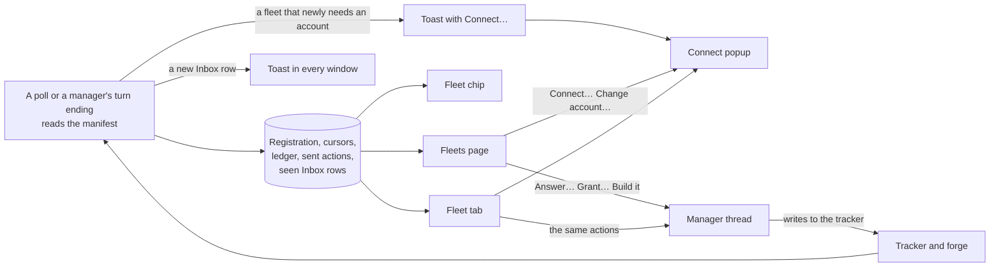

# Unattendish: the Fleets page, the Fleet chip and the Fleet tab

What the operator sees of their fleets. The pages only read what the plugin keeps, send the manager a message when the operator acts, and open **Connect…** to give a fleet an account; they write nothing to a tracker or forge. Source: [`views.ts`](../../plugins/unattendish-sdlc/src/fleet/application/views.ts) (what the pages read), [`rpc.ts`](../../plugins/unattendish-sdlc/src/fleet/adapters/rpc.ts), [`app.tsx`](../../plugins/unattendish-sdlc/app.tsx). To do the jobs, see [answer, grant or build from the dashboard](../how-to/unattendish-answer-from-the-dashboard.md) and [connect a fleet to an account](../how-to/unattendish-connect-a-fleet.md). The words are defined in the [Unattendish glossary](../../plugins/unattendish-sdlc/GLOSSARY.md).

## What the numbers count

| Count | What |
|---|---|
| Waits on you | Every Inbox row of the fleet: rows the plugin cannot read, rows waiting for `other`, and rows whose action is *sent* all count, since each still waits until the manager acts. On the Fleets page the heading's number, and the one in the navigation, also count each half of a fleet that needs an account, which waits on you to connect it |
| In flight | The In flight rows |
| Landed today | The Landed rows whose Merged falls on today's date, by the bb server's clock and time zone |

A fleet whose manifest is missing or unreadable counts zero in each. The Fleets page's header counts every fleet's Waits on you, and shows nothing at zero. A card's own count is its Inbox rows alone.

## The Fleets page

Open it from **Fleets** in bb's navigation. It has three parts, in this order. An Inbox row's age, a card's "polled" time and a manager's "idle for" count from the server's clock.

| Part | What it shows |
|---|---|
| **Waits on you** | At its top, a **Needs an account** list: for each fleet half that no account reads, what it needs, such as `other-org/x needs a GitHub account that can read other-org`, with **Connect…**. Beneath it, a table of Inbox rows. Every Inbox row of every fleet, longest wait first: the fleet, what it is, what it waits for, how long it has waited, a link to the item on the tracker or forge, and its action. A row waiting for `other` has its link and no action. A row the plugin cannot read reads `unreadable: <column>`, links to that fleet's Fleet tab, and counts as waiting. On a compact viewport each row stacks its fleet, what it is and its wait above its action. Beneath it, the actions finished in the last hour whose row has left the Inbox |
| **Cards** | One for each registered fleet; see below |
| **Recently landed** | Each spec landed in any fleet in the last 7 days, newest first, with its fleet, its title and a link to the pull request that merged |

With no fleet registered the page says none is, and that a fleet appears once `/run-fleet` from unattendish-sdlc runs with this plugin installed. An empty Inbox reads "Nothing waits on you", and an empty strip "Nothing landed in the last 7 days".

### A card

| Line | What |
|---|---|
| Name | The repository, with a link that opens the manager's thread on its Fleet tab |
| Manager | `working`; `idle` and for how long; or `no manager` when its thread is archived or gone. How long is the thread's last update, which is approximate |
| Counts | Waits on you, in flight and landed today, a count of zero left out |
| Cost | The manager's thread tree's total from Thread Usage, "since this manager started". Left out, with no error, where Thread Usage is not installed or its answer cannot be read. Cached for 30 seconds |
| Polled | When the fleet was last polled |
| Accounts | One line for the `forge` and one for a `tracker` of its own: what it reads (`acme/web`, `team ENG`, `OPS`), `reads as GitHub · yuser` or `no account yet`, **can write** where the credential can, and what it needs. A half that needs something offers **Connect…**; a half that is read offers **Change account…**. Both open the [Connect popup](../how-to/unattendish-connect-a-fleet.md#connect-a-half) for that half |
| Reasons | Every reason the fleet is not fully watched: the [`notWatched` reasons](unattendish-fleet-contract.md), an outage the poll found, and how many manifest rows cannot be read and in which sections. Each links to where it is put right: a credential reason to **Connect…**, a missing or unreadable manifest or unreadable rows to the Fleet tab |
| Warnings | A credential the service says expires within 7 days, or has expired (`token expires in 3 days`, `token expires today`, `token expired 2 days ago`), with the credential and **Renew**; and, for a `gh` or `glab` login, that it shares the fleet's agents' rate limit |

## The Fleet chip

A button in a manager thread's header, shown only on a thread that holds a registration. It spells out the card's counts, leaving out any that is zero: `1 waits on you · 3 in flight · 2 landed today`, or `Fleet idle` when all are. Counts of up to 45 characters share one line; longer ones are set on two short lines inside the same header row. Its accessible name always carries every count. Hovering shows the card; clicking opens the Fleet tab. On a compact viewport it shows only the Waits on you count, or a dot with none, and tapping it opens the tab.

## The Fleet tab

Opened from the chip, from a card's link, or from **Fleet** in a thread panel's new-tab Actions list, on any thread. On a thread that holds no registration it says so and names the manager holding the thread's repository, where there is one. On a manager it shows:

| Section | What |
|---|---|
| Card | The fleet's card |
| Inbox | The rows with their actions, as on the Fleets page |
| In flight | Each row's stage, how long it has been at it, a link to its builder thread and to its item |
| Blocked | Each row and what it is blocked on |
| Landed | The last 7 days, with links to the pull requests |
| Backlog, Set aside, Standing orders and any other section | As the manifest writes them |
| Unreadable rows | Each row the plugin cannot read, with its section, line and the column |
| Watched set | Each item and why it is in it: `named in In flight`, `named in Inbox`, `named in Blocked`, `blocked on <Ref>`, or `carries the spec label` or `carries the ready label` |
| Credentials | Each credential the fleet uses: the account it is read as beside it, its kind, **can write** where it can, its expiry date or `no expiry reported`, and whether it shares the agents' rate limit |
| Polling | The poll interval, when the fleet was last polled and the requests spent this hour |
| Ledger | The fleet's [ledger](unattendish-cli.md#bb-unattendish-fleet-ledger), filterable by item and by what was done, with dropped changes grouped by reason and a count for each, so a noisy echo source stands out; a Jira poll cut off at its page limit shows as `out of scope: listing cut at its page limit`, with the window it listed and the last update it reached where a change shows its ref, kind and actor. A change shows once: under All the list holds the changes that were not dropped, and the groups hold the dropped ones; an item filter hides the wakes, which name no item |

A table shows at most 200 rows, and the Fleets page at most 400 in all; the counts are of every row. The ledger shows at most 250 changes, as the command does.

## Toasts

A fleet that newly needs an account raises a toast in every open bb window, saying what it needs, with **Connect…**, which opens the popup over the view that is open. There is one toast for each half of a fleet, so a signal delivered twice raises one. It appears when a fleet becomes not watched for want of an account, a credential the service refuses, or a credential that cannot read the repository, and not again while the reason stays.

When a poll or a manager's turn ending shows an Inbox row never seen before for its repository, every open bb window shows a toast naming the fleet and the row, which opens the Fleets page. A row is told apart by its Ref, what it waits for, its Since and, for a row with no Ref, its Link.

The plugin keeps which rows it has seen for each repository, so opening a window, reloading, restarting bb and taking a fleet over toast nothing. Registering a fleet whose manifest can be read records its rows without a toast; registering one whose manifest is missing records none, so the first rows the manager writes toast.

## Actions

An action sends the manager one message, a plain prompt in the operator's voice with nothing that names the plugin. The manager acts on the tracker as it always does; the plugin sends no write.

| Action | On an Inbox row waiting for | The message | Done when a poll sees |
|---|---|---|---|
| Answer… | `answer` | `Answer to <Ref>: ` and the operator's text, or `Answer to message <n>: ` where Ref is `—` | The row gone from the Inbox |
| Grant… | `grant` | `Grant: ` and the operator's text | The row gone from the Inbox |
| Re-grant | `grant`, where the Link names a previous manager's message | `Grant: ` and the row's What | The row gone from the Inbox |
| Build it | `ready` | `Build <Ref>` | The spec carrying the ready label, or the row gone from the Inbox |

Answer… and Grant… open a composer showing the row's What and a link to the park. The text takes several lines, follows the prefix and runs to the end of the message; ⌘/Ctrl+Enter sends, Esc cancels, and nothing sends while it is empty. The message is queued behind a running turn.

An action is *sent* once bb accepts the message, and *done* once a poll or a manager's turn ending sees its result. The plugin keeps it, so every window shows the row as *sent* with its age and no action, after a reload too. A sent action is never marked failed for waiting. A done action is shown for an hour, then dropped from the page, and the plugin deletes it after a day. If bb refuses the message, the row shows *not sent* with bb's reason, such as `HTTP 409: Thread is archived`, and keeps its action. The reason is bb's message cut to 160 characters, with the text you sent and any configured token replaced; it reaches only the page, never the ledger or the log, where a refused wake is recorded as its status alone. If the call fails with no answer, the row says the result is unknown and shows what the plugin recorded.

Esc or Cancel discards what was typed; a refusal keeps it in the open composer.

A takeover drops the actions still *sent* on the fleet, since the new manager never received them, and the rows offer their actions again. A message sent while a takeover happens is refused with a reason, because it went to the manager the fleet no longer has.

## Live updates

The pages refetch when the server publishes `board-changed`, at most once a second whatever the number of polls, when a connection returns, and every 60 seconds. `inbox-new` carries a new row's fleet, Ref, What (cut to 500 characters) and id, for the toast. `fleet-needs` carries a fleet, its manager's thread, the half (`forge` or `tracker`) and what it needs, for the Connect… toast.
