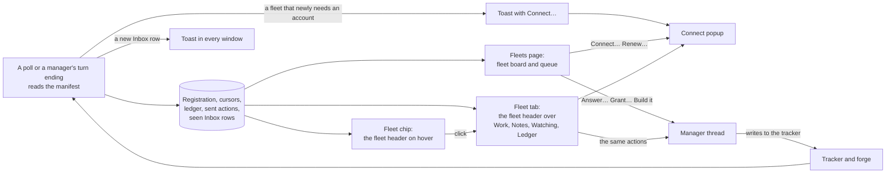

# Unattendish: the Fleets page, the Fleet chip and the Fleet tab

What the operator sees of their fleets. The pages only read what the plugin keeps, send the manager a message when the operator acts, and open **Connect…** to give a fleet an account; they write nothing to a tracker or forge. Source: [`views.ts`](../../plugins/unattendish-sdlc/src/fleet/application/views.ts) (what the pages read), [`rpc.ts`](../../plugins/unattendish-sdlc/src/fleet/adapters/rpc.ts), [`app.tsx`](../../plugins/unattendish-sdlc/app.tsx). To do the jobs, see [answer, grant or build from the dashboard](../how-to/unattendish-answer-from-the-dashboard.md) and [connect a fleet to an account](../how-to/unattendish-connect-a-fleet.md). The words are defined in the [Unattendish glossary](../../plugins/unattendish-sdlc/GLOSSARY.md).

## What the numbers count

| Count | What |
|---|---|
| Blocked | The Blocked rows |
| In flight | The In flight rows |
| Waits on you | Every Inbox row of the fleet: rows the plugin cannot read, rows waiting for `other`, and rows whose action is *sent* all count, since each still waits until the manager acts |
| Landed in the last 7 days | The Landed rows merged in the 7 days before now. A row whose time cannot be read is left out |

A fleet whose manifest is missing or unreadable counts zero in each. The title bar's count and the navigation's are every fleet's Waits on you, Inbox rows alone: a fleet half that needs an account adds nothing to it, since the fleet board offers **Connect…** for it instead. Neither shows at zero.

## The Fleets page

Open it from **Fleets** in bb's navigation. It is the **fleet board** over the **queue**. An Inbox row's age, a fleet's "late" time and a manager's idle time count from the server's clock.

### The fleet board

One line for each fleet that is not quiet, in this order, left to right.

| Part | What it shows |
|---|---|
| Name | The forge's logo (GitHub's; GitLab shows its name) and the fleet's name. Where the tracker is Linear or Jira, its name and key follow: Linear's team key, Jira's project key. A tracker that is the forge's issues adds nothing |
| Manager | A turning icon while it works, with no time, since the plugin cannot know how long; a cup with how long it has been idle; a red person with a cross when its thread is archived or gone. The icon's accessible name and hover text say the state. How long is the thread's last update, which is approximate |
| Status | Four fixed slots in this order: Blocked, In flight, Waits on you, Landed in the last 7 days. A count of zero leaves its slot empty and the others keep their places. Hovering a slot names its count, and the header lists the four |
| Spend | The manager's thread tree's total from Thread Usage, "since this manager started". Empty, with no error, where Thread Usage is not installed or its answer cannot be read. Cached for 30 seconds |
| Polling | Empty while polling is healthy. `not yet` where the fleet has never been polled; amber `9m late` where the last poll is more than twice the fleet's poll interval ago |
| Fix | The first of the fleet's problems and warnings as a coloured verb, with the full sentence on hover, and `+N` when there are more, in which case the hover lists every sentence. See below |
| Fleet tab | An icon that opens the manager's thread on its Fleet tab |

A problem is red, a warning amber, and a fleet with either has a bar of that colour on the left edge of its line. A fleet with both is red. The fix verb is one of these, in the order a fleet's flags are ranked:

| Flag | Kind | Shown as | Opens |
|---|---|---|---|
| The manifest is missing or unreadable | Problem | **Review** | The Fleet tab |
| Manifest rows the plugin cannot read | Problem | **Review** | The Fleet tab |
| A half no account reads, or whose credential the service refuses or cannot read the repository with | Problem | **Connect…** | The [Connect popup](../how-to/unattendish-connect-a-fleet.md#connect-a-half) for that half |
| The manager thread is archived or gone | Problem | A red ✕, whose sentence says to run `/run-fleet` in a new thread to take the fleet over | Nothing |
| Any other [`notWatched` reason](unattendish-fleet-contract.md), or an outage the poll found | Problem | A red ✕ | Nothing |
| A credential that expires within 7 days, or has expired | Warning | **Renew…** | The Connect popup, to renew it |
| Polling is late or has never run | Warning | Nothing: the polling cell says it | Nothing |

A credential sharing the agents' rate limit is a warning on the fleet's card and not on the board.

Fleets are listed with problems first, then warnings, then the rest with the most waiting first and ties in name order. A **quiet fleet**, with every Status count at zero, no problem and no warning, is folded under one line, `N quiet fleets`, which unfolds them when pressed. Clicking a line, anywhere but its buttons, or its name, filters the queue to that fleet; the line shows as selected and a chip with the fleet's name and an ✕ appears beside the queue's tabs. Clicking the line again or the ✕ clears the filter. A fleet selected as the filter is listed even if it is quiet. The Fleet tab icon, **Connect…**, **Renew…** and **Review** act without changing the filter.

### The queue

One list of every Inbox row across fleets, oldest first. Its tabs:

| Tab | Lists |
|---|---|
| All | Every row, the unreadable ones among them |
| Answer | Rows waiting for `answer` |
| Grant | Rows waiting for `grant` |
| Build | Rows waiting for `ready` |
| Other | Rows waiting for `other` |
| Unreadable | Rows the plugin cannot read; the tab shows only while there is one |
| Sent | The actions seen done in the last hour, set apart by a divider: `You answered #5 Which queue · 40m ago · done`. An action still *sent* shows on its row in the queue instead |

Each tab shows its count; with the queue filtered to one fleet the counts and the lists cover that fleet only, and the fleet is left off each row. A row shows, in this order:

| Part | What |
|---|---|
| Kind | The icon of what it waits for: a speech bubble for an answer, a merge icon for a grant, a rocket for a ready label, a dashed circle for something else |
| Title | Its Ref and What |
| Link | A short link to the item on the tracker or forge, such as `#7 ↗` |
| Age | How long it has waited, amber after 8 hours |
| Fleet | The forge's logo and the fleet's name |
| Action | See [Actions](#actions) |

A row waiting for `other` has its link and no action: the cell reads `watch only`. A row the plugin cannot read is a red line, `Unreadable Inbox row, line N: <reason>`, with **Review**, which opens that fleet's Fleet tab; it counts as waiting. On a compact viewport each row takes two lines: the title and action on the first, the fleet, link and age on the second.

### Around the board and queue

| State | The page shows |
|---|---|
| Loading | Grey bars in the shape of the board and the queue |
| No data and an error | `Couldn't load your fleets` with the error and **Try again**, which reloads at once. The page retries every minute |
| A refresh fails over data already shown | The data stays, and an amber pill in the title bar reads `3m old`, the age of the data, with a reload button. Hovering it gives the error |
| No fleet registered | `No fleet is registered`, and that a fleet appears once `/run-fleet` from unattendish-sdlc runs with this plugin installed |
| Empty Inbox | `Nothing waits on you`. The tabs stay, and Sent still lists what was done in the last hour |

### On a compact viewport

Below 768 px the board shows three lines: each has the fleet's logo and name, a ⚠ for a problem or a key for a warning that **Renew…** fixes, and its non-zero Status counts. The rest fold under `N more fleets`. Tapping a line filters the queue as above. The ⚠ or key is a touch-sized button that does what the verb does, since a phone has no hover; its accessible name is the full sentence. The tabs are pills.

## The fleet header

What the Fleet tab opens on and the Fleet chip shows on hover, in this order:

| Line | What |
|---|---|
| Fleet | The forge's logo, the fleet's name, and a tracker of its own as its name and key: Linear's team key or Jira's project key. GitHub shows its logo; GitLab, Linear and Jira show their names, since their trademark rules refuse third parties or forbid recolouring their logos |
| Manager | A turning icon in green while it works, with no duration, since the plugin cannot know how long it has worked; a cup in grey with how long it has been idle; a person with a cross in red when its thread is archived or gone. A thread bb did not answer for also shows no manager, without the problem a gone manager raises |
| Status | The four counts, each an icon and a number in its colour, a zero left out: blocked grey, in flight blue, waits on you amber, landed in the last 7 days purple |
| Spend | As the board's Spend, where there is one |
| Problems and warnings | Each as one strip tinted red or amber, with the server's sentence and its verb, in the board's order: **Connect…** for a half with no account or a credential connecting another account fixes; **Review** for a missing or unreadable manifest or rows that cannot be read; **Renew…** for a token that expires within 7 days; none for a problem nothing on the page fixes, late or never-run polling, or a gone manager, whose sentence says to run `/run-fleet` in a new thread to take the fleet over |
| Last action | The action seen done most recently in the last hour whose row has left the Inbox: `You answered #5 Which queue · done 40m ago`. Left out with none |

## The Fleet chip

A button in a manager thread's header, shown only on a thread that holds a registration: the fleet icon, then, when at least one row waits on you, that count in amber. A small red dot on the icon marks a problem, an amber one a warning alone. With nothing waiting and no problem or warning it is the icon alone. Its accessible name gives the count and says when the fleet has a problem or a warning: `Fleet: 6 waiting on you, and it has a problem`.

It is drawn like the controls beside it in bb's header, as tall as the header, with a border on desktop and none on a compact viewport, and never wraps. Hovering it shows the fleet header with `Click the chip to open the Fleet tab`; its **Review** opens the Fleet tab. Clicking or tapping the chip opens the Fleet tab. A compact viewport has no hover card. While its data loads, or when it failed to load, it draws nothing.

## The Fleet tab

Opened from the chip, from the board's Fleet tab icon or **Review**, from a queue row's **Review**, or from **Fleet** in a thread panel's new-tab Actions list, on any thread. On a thread that holds no registration it reads `This thread runs no fleet.` and names the manager holding the thread's repository, where there is one, with a link to it. On a manager it shows the fleet header over four tabs, each with a count; the tab bar stays at the top while the tab scrolls, and the arrow keys move between tabs. Work opens first.

| Tab | Its count | What |
|---|---|---|
| Work | The rows that wait on you, in amber | The manifest's rows, in four folding sections below |
| Notes | The sections the manifest writes | Backlog, Set aside, Standing orders and any other section, each under its own heading, rendered as Markdown; `Nothing written.` under a blank one |
| Watching | The items in the watched set | The watched set, the credentials and polling, below |
| Ledger | The reads that failed in the last 24 hours, in red; none when no read failed | The ledger, below. It loads when its tab first opens |

**Review** in the header opens Work at what needs reviewing: the section holding the first row the plugin cannot read, in section order, unfolded, scrolled to that row. When the manifest is missing or cannot be read, Work and Notes show that in place of their content: `No manifest was found at the path the fleet registered.`, or `The manifest cannot be read: <reason>`.

### Work

Each section is a heading with its icon, its name and how many lines it lists; clicking the heading folds or unfolds it. Waits on you, In flight and Blocked start open, Landed folded. Each section lists the rows the plugin cannot read in it as red lines, `Unreadable row, line N: <reason>`.

| Section | Each row | When empty |
|---|---|---|
| Waits on you | Two lines: the icon of what it waits for and the title; then the item's short link with ↗ and its age, amber once it has waited 8 hours. The action sits at the right, with the queue's states and composer | `Nothing waits on you` |
| In flight | Its stage's icon in blue, the title, the short link, `<stage> for <duration>`, and **builder** linking to its builder thread where it has one | `Nothing in flight` |
| Blocked | The blocked icon, the Ref, its link, and `waits for <Ref>, <Ref>`, each Ref linking to its item where the watched set knows it | `Nothing blocked` |
| Landed | The merged icon, the title, its pull request's link, and `merged <date and time>` | `Nothing landed in the last 7 days` |

In flight's icons, by stage:

| Stage | Icon |
|---|---|
| building | A hammer |
| asking | A speech bubble |
| waiting on you | A bell |
| under review | An eye |
| at the bar | Scales |
| round open | Repeat arrows |
| brainstorming | A light bulb |

### Watching

| Block | What |
|---|---|
| Watched set | Each item's short link and why it is in it: `named in In flight`, `named in Inbox`, `named in Blocked`, `blocked on <Ref>`, or `carries the spec label` or `carries the ready label` |
| Credentials | A small card for each credential the fleet uses: the service's logo or name, the account, the half it reads (`reads the forge`), its kind, **can write** where it can, its expiry date or `no expiry reported`, `shares the agents' rate limit` in amber for a `gh` or `glab` login, and **Change account…**, which opens the Connect popup for that half |
| Polling | `every <interval> · polled <age> ago · <n> requests this hour` |

### Ledger

The fleet's [ledger](unattendish-cli.md#bb-unattendish-fleet-ledger). A row of pills filters it by what was done (All, Woke, Dropped, Held, Failed reads, Wakes) and a search box by item. The changes are a timeline, newest first: each shows its time, its Ref, kind and actor, and what was done with it, marked by an icon in the outcome's colour: woke amber, dropped as an echo or out of scope grey, held grey, a failed read red. **Dropped, by reason** groups the dropped changes with a count for each, so a noisy echo source stands out; a Jira poll cut off at its page limit shows as `out of scope: listing cut at its page limit`, with the window it listed and the last update it reached where a change shows its Ref, kind and actor. **Wakes** lists the wakes. A change shows once: under All the timeline holds the changes that were not dropped, and the groups hold the dropped ones; an item filter hides the wakes, which name no item.

A section shows at most 200 rows, and the queue at most 400 in all; the counts are of every row. The ledger shows at most 250 changes, as the command does.

## Toasts

A fleet that newly needs an account raises a toast in every open bb window, led by a red plug. Its title is `<fleet> can't be read`, the server's sentence for what it needs is under it, and its button **Connect…** opens the popup over the view that is open. There is one toast for each half of a fleet, so a signal delivered twice raises one. It appears when a fleet becomes not watched for want of an account, a credential the service refuses, or a credential that cannot read the repository, and not again while the reason stays.

When a poll or a manager's turn ending shows an Inbox row never seen before for its repository, every open bb window shows a toast. Its title is the item, such as `#7 Which cache to use`, led by the icon of what the row waits for, and the line under it is the forge's logo and `<fleet> waits for <your answer | a grant to merge | your ready label | something else>`. Its button **Open Fleets** opens the Fleets page. A row is told apart by its Ref, what it waits for, its Since and, for a row with no Ref, its Link.

The plugin keeps which rows it has seen for each repository, so opening a window, reloading, restarting bb and taking a fleet over toast nothing. Registering a fleet whose manifest can be read records its rows without a toast; registering one whose manifest is missing records none, so the first rows the manager writes toast.

## Actions

An action sends the manager one message, a plain prompt in the operator's voice with nothing that names the plugin. The manager acts on the tracker as it always does; the plugin sends no write.

| Action | On an Inbox row waiting for | The message | Done when a poll sees |
|---|---|---|---|
| Answer… | `answer` | `Answer to <Ref>: ` and the operator's text, or `Answer to message <n>: ` where Ref is `—` | The row gone from the Inbox |
| Grant… | `grant` | `Grant: ` and the operator's text | The row gone from the Inbox |
| Re-grant | `grant`, where the Link names a previous manager's message | `Grant: ` and the row's What | The row gone from the Inbox |
| Build it | `ready` | `Build <Ref>` | The spec carrying the ready label, or the row gone from the Inbox |

Answer… and Grant… open a composer under the row. Its header reads `Your answer for #7 Which cache to use · goes to org/dash's manager`, beside a link to the item or the park, and its hint `⌘↵ send · Esc cancel`. The text takes several lines, follows the prefix and runs to the end of the message; ⌘/Ctrl+Enter sends, Esc cancels, and nothing sends while it is empty. A compact viewport has no such keys and leaves the hint out. The message is queued behind a running turn.

An action is *sent* once bb accepts the message, and *done* once a poll or a manager's turn ending sees its result. The plugin keeps it, so every window shows the row's action cell as `sent · 4m` and no action, after a reload too. While the call is in flight the cell reads `sending…`, while the words are being written `composing…`, and a Build it that a poll saw done while its row is still in the Inbox reads `done`. A sent action is never marked failed for waiting. A done action leaves the queue with its row and is listed under Sent for an hour, then dropped from the page, and the plugin deletes it after a day. If bb refuses the message, an Answer… or Grant… composer stays open with the draft and its footer reads `Not sent: <reason>`, such as `Not sent: HTTP 409: Thread is archived`; a refused Build it or Re-grant, which have no composer, shows a red `not sent` beside the row's title with the reason on hover. The row keeps its action. The reason is bb's message cut to 160 characters, with the text you sent and any configured token replaced; it reaches only the page, never the ledger or the log, where a refused wake is recorded as its status alone. If the call fails with no answer, the cell reads `checking…` until the page has fetched what the plugin recorded, and then shows that.

Esc or Cancel discards what was typed; a refusal keeps it in the open composer.

A takeover drops the actions still *sent* on the fleet, since the new manager never received them, and the rows offer their actions again. A message sent while a takeover happens is refused with a reason, because it went to the manager the fleet no longer has.

## Live updates

The pages refetch when the server publishes `board-changed`, at most once a second whatever the number of polls, when a connection returns, and every 60 seconds. `inbox-new` carries a new row's fleet, Ref, What (cut to 500 characters), id, what it waits for (`waitsFor`) and the forge's service (`forge`, `github` or `gitlab`), so the toast draws its icon, line and logo without a fetch. `fleet-needs` carries a fleet, its manager's thread, the half (`forge` or `tracker`) and what it needs, for the Connect… toast.
