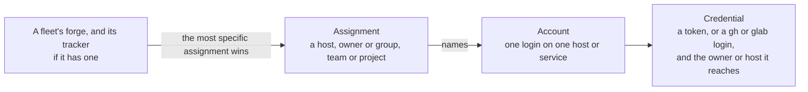

# Unattendish: settings and what it stores

The plugin has no `bb plugin config` key. It keeps its accounts, their credentials and the assignments in its own database, and shows them in one settings section, under Settings → Installed plugins → Unattendish, titled **Fleets: accounts and polling**. A change applies at once, without a reload. Source: [`src/fleet/domain/accounts.ts`](../../plugins/unattendish-sdlc/src/fleet/domain/accounts.ts) (the rules), [`src/fleet/application/accounts.ts`](../../plugins/unattendish-sdlc/src/fleet/application/accounts.ts) (what Connect and the section do), [`features/accounts-settings/`](../../plugins/unattendish-sdlc/features/accounts-settings), [`src/fleet/adapters/account-store.ts`](../../plugins/unattendish-sdlc/src/fleet/adapters/account-store.ts) and [`src/fleet/adapters/store.ts`](../../plugins/unattendish-sdlc/src/fleet/adapters/store.ts). To connect a fleet to an account, see [connect a fleet to an account](../how-to/unattendish-connect-a-fleet.md). The words are in the [Unattendish glossary](../../plugins/unattendish-sdlc/GLOSSARY.md).

## The settings section

| Part | What |
|---|---|
| **Accounts** | One entry for each [account](#accounts); see below. With none, it says `No account is connected.` |
| **Add account** | Opens the Connect popup without a fleet. It asks for the service and its host or Jira site, and for GitHub the owner the token is for, and lists that owner's registered fleets to tick on the token. It then asks for a credential and verifies it as Connect does. The first account on a host or site becomes its default |
| **Poll interval** | One field in seconds for each registered fleet, with **Set** and a **Default** button back to the default. Under 30 seconds is refused |

## Accounts

An account is one login on one host or service: `GitHub · yuser` and `GitHub · buser` on github.com are two accounts, and so is `GitLab · yuser` on gitlab.example.com, a Linear key and its user, or a Jira Cloud account on a site. Each entry shows:

| Line | What |
|---|---|
| Name | The account as `GitHub · yuser`, its host (for Linear `linear.app`, for Jira its site), **can write** where the account uses a `gh` or `glab` login, `default for <host>` where it is that place's default, and **Make default** on the other accounts of a place |
| Credentials | One for each token or login the account holds: what it reaches (an owner on GitHub, the host on GitLab, every team the key reaches on Linear, the site on Jira), its kind, **can write** where it can, its expiry or `no expiry reported` or `refused by the service`, and `read by <fleets>` or `no fleet reads with it`. Each has **Remove**, and **Renew** where one is given |
| Assignments | The owners, groups, Linear teams and Jira projects assigned to the account, each with **Remove**, which returns them to the default |
| Actions | **Add token for another owner**, on a GitHub account that uses tokens, which opens the popup at step 2; and **Remove**, which asks first |

An account's login comes from its first token and is shown for you to confirm; for a `gh` or `glab` account it is picked from that tool's logins. Its service and host or site, and its API address, are fixed once it is added.

A credential is one of:

| Kind | Reaches | Can write |
|---|---|---|
| Fine-grained token (GitHub) | One owner | No |
| Classic token (GitHub), pasted only for an owner GitHub cannot issue a fine-grained token for | Every owner of its account | **Yes** |
| Personal access token (GitLab) | The host | No |
| API key (Linear) | Every team the key reaches | No |
| API token (Jira) | The site | No |
| `gh` login, `glab` login | Every owner or the host, as the login can | **Yes** |

The plugin only reads. **can write** says the credential could write, wherever it is shown: Settings, the popup, the Fleet tab's credential cards and `bb unattendish fleet status`.

### Expiry and refused credentials

A credential whose token expires within 7 days, or has expired, shows `token expires in N days`, `token expires today` or `token expired N days ago` in Settings and on the cards of the fleets it serves, with **Renew**. `expiresAt` is what the service reports: a GitHub token that expires and a GitLab personal access token with an expiry date; none for a Linear or Jira key. A credential the service now refuses shows `refused by the service`, and its fleets show **Connect…**.

| Credential | **Renew** |
|---|---|
| GitHub or GitLab token | Opens the same pre-filled page as **Create token**, with the same repositories to tick. A token saved through it replaces the old one |
| Linear or Jira key | Opens the field to paste a new one, checked like any other |
| `gh` or `glab` login | None. Settings shows `gh auth login --hostname <host>` (or `glab auth login`) to run as the account's login |

### Remove

| Remove | Does |
|---|---|
| A credential | Deletes its token from the plugin's database. Its fleets then need an account |
| An account | Deletes all its tokens, and its default if no fleet reads as it. It is refused while a registered fleet reads as the account, and the refusal names those fleets |
| An assignment | Returns the owner, group, team or project to the host's default. The default itself is changed with **Make default** on another account |

After a **Remove** or a **Renew**, Settings says the old token still works at the service until it expires or is revoked there, and links to the service's token page. Removing a `gh` or `glab` credential says the login stays signed in on the machine, and that `gh auth logout` (or `glab auth logout`) signs it out.

## Assignments

An assignment says which account reads a host or an owner or group. A fleet's forge is matched against its repository, and its tracker against the Linear team or Jira project it names. Of the assignments that cover it, the one with the most segments wins: a Linear team or a Jira project beats a bare `linear:` or a site. An assignment names only an account on the host, site or service it covers, and is refused otherwise, naming both. The assignment on a bare host or site, or on `linear:`, is that place's **default**, and the first account on a place becomes it.

| Scope | Covers |
|---|---|
| `github.com` | Every repository on the host |
| `github.com/org` | Every repository under an owner or a group path |
| `linear:` | Every Linear team |
| `linear:ENG` | One Linear team, by its key |
| `jira:example.atlassian.net` | Every project of a Jira Cloud site |
| `jira:example.atlassian.net/PROJ` | One Jira project, by its key |

A scope matches only a whole host and whole path segments, without regard to case: `github.com/or` does not cover `github.com/org/repo`, and `gitlab.com` does not cover `gitlab.com.evil.net/x`. An assignment is never made for one repository, since a credential covers an owner.

A fleet with no assignment covering a half, or whose account holds no credential reaching it, is not watched, and the fleet board and the fleet header say what it needs, with **Connect…**. Choosing an account in Connect assigns it the fleet's owner or group (the repository path without its last segment), or the fleet's Jira project or Linear team; choosing the default again removes that assignment.

## Where a token goes

A token is sent only to its own account's host, whoever changed the account. It goes over https only; plain http is allowed only on loopback.

| Service | The token goes to |
|---|---|
| GitHub on `github.com` | `https://api.github.com` |
| GitHub on another host (GitHub Enterprise Server) | `https://{host}/api/v3` |
| GitLab | `https://{host}/api/v4` |
| Linear | `https://api.linear.app/graphql` |
| Jira | `https://{site}`, a host ending in `.atlassian.net` |

An account may carry an API address of its own for a service whose API root differs, only on its own host (for github.com also `api.github.com`) or on loopback (`127.0.0.1`, `localhost` and `[::1]`, so a fake service can stand in for a test). It is set through the plugin's RPC when the account is added, cannot be changed afterwards, takes no user name or password, and is not shown on screen. A `gh` or `glab` account takes none. No call changes an account's service, host or site once it is added. An item is read only where it lies under the fleet's repository or tracker, and any other Ref or Link is never requested. An item that has moved out of the fleet is not followed either; it is recorded as a failed read, `moved outside the fleet`.

A `gh` or `glab` login is asked for its token on the bb server, as the user bb runs as, for the account's host and login: `gh auth token --hostname {host} --user {login}`, or `glab auth status --hostname {host} --show-token`. The command runs without a shell and gets 10 seconds. The variables `gh` and `glab` read before their own login (`GH_TOKEN`, `GITHUB_TOKEN`, `GH_ENTERPRISE_TOKEN`, `GITHUB_ENTERPRISE_TOKEN`, `GITLAB_TOKEN`, `GITLAB_ACCESS_TOKEN` and `OAUTH_TOKEN`) are removed from its environment, so the login you chose is the one used. The account reads only as its own login: a token for another user shows `gh is signed in as yuser, not buser`, and its fleets are not watched with reason `no-credential`. The token is kept in memory for 5 minutes. A login is the same account the fleet's agents use, so its reads share their rate limit; `bb unattendish fleet status` says so for each fleet.

## The polling interval

Each fleet is polled every 2 minutes unless its own interval is set. The shortest is 30 seconds. Set it for one fleet with [`bb unattendish fleet interval`](unattendish-cli.md#bb-unattendish-fleet-interval) or in the [settings section](#the-settings-section); there is no global setting. The plugin checks which fleets are due every 5 seconds, so a poll starts up to 5 seconds after its interval ends.

## What it stores

| Where | What | For how long |
|---|---|---|
| `<data dir>/plugins/unattendish-sdlc/data.db` (SQLite) | Each fleet's registration, its cursors and the state of its last poll | Until [unregistered](unattendish-cli.md#bb-unattendish-fleet-unregister) |
| The same file | The Inbox rows it has seen for each repository, which keeps a toast from repeating, and the dashboard's actions with whether each is sent or done | The rows until the fleet is unregistered; a done action for a day |
| The same file | The ledger: every change seen, each wake with its queued and dispatched times, each poll's requests, and each failed read | 30 days, also after the fleet is unregistered; the plugin deletes older rows hourly |
| The same file | The accounts, their credentials with each pasted token, and the assignments, and which credentials the services accepted but could not read a fleet with | Until removed in Settings |

A token is stored only as a row of the credentials. It is in no wake, no ledger entry, no log line, no refusal and no answer to the frontend, and no `bb unattendish` command shows or takes one. The registration holds the marker, the labels and the echo actors but no token. A change holds no text written on the service.

`bb plugin remove` deletes a plugin's settings, its secrets and its schedules, and the plugin is given no signal when it is removed. So **`bb plugin remove` leaves `data.db` on disk, with every registration, cursor and ledger row and every stored token.** Installing the plugin again polls the registered fleets again with the accounts it finds. To delete the tokens, remove every account in Settings before you uninstall; revoke them at the services too, since removing deletes only the plugin's copy. To start from nothing, delete `data.db` while the plugin is uninstalled.

## What it sends off the server

Reads, and only reads, to the services the accounts name: a GET, or a GraphQL query with no mutation. The plugin reads no CI: no check run, commit status, Actions run or pipeline. Nothing is sent to a service no account covers, and a token goes only to its own account's host. Connect sends a pasted token to the service once to ask whose it is, and to read the fleet's repository, before it stores it. The plugin sends the manager's thread one message per poll, the [wake](unattendish-cli.md#the-wake).
