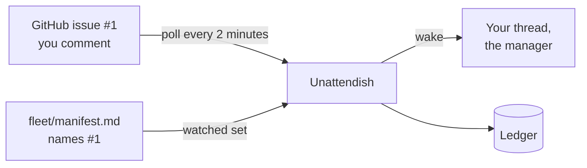

# Unattendish: first run

In this tutorial you install Unattendish, give it a GitHub token, register a fleet from a thread the way a manager does, read its status, and watch the first wake arrive when a comment lands on an item the manager's manifest names. You need a bb server you can install plugins on, a GitHub repository with issues that you can comment on, and a bb thread whose agent can run `bb` commands. The thread plays the manager that run-fleet would normally be.



The commands use `github.com/acme/widgets`, issue `#1` and the login `olivia`. Use your own repository, an issue in it, and your GitHub login.

## 1. Install it

```sh
bb plugin install git:https://github.com/gperezmz/bb-plugins.git@main --plugin unattendish-sdlc
bb unattendish fleet status
```

The second command prints `No fleet is registered.` Unattendish polls nothing until a manager registers a fleet.

## 2. Give it a GitHub token

Create a [personal access token (classic)](https://docs.github.com/en/authentication/keeping-your-account-and-data-secure/managing-your-personal-access-tokens) that can read the repository: the `repo` scope for a private repository. Unattendish only reads. Then, under Settings → Installed plugins → Unattendish:

1. In **Credentials**, enter

   ```json
   [{"prefix": "github.com/acme/widgets", "auth": "token"}]
   ```

2. In **Tokens**, enter your token against the same prefix:

   ```json
   {"github.com/acme/widgets": "ghp_…"}
   ```

Save both. **Tokens** is a secret setting, and no `bb unattendish` command takes a token. [Set the credentials](../how-to/unattendish-set-credentials.md) covers a `gh` login, GitLab, Linear and Jira.

## 3. Register a fleet from a thread

In the thread, ask its agent to run this. A manager runs it from its own thread, and from your terminal, which names no thread, it exits with `no_thread`.

```sh
bb unattendish fleet register --contract 1 \
  --repo github.com/acme/widgets --tracker forge-issues \
  --manifest "$PWD/fleet/manifest.md" --operator olivia \
  --label-spec spec --label-ready ready \
  --label-in-progress in-progress --label-needs-input needs-input \
  --marker tutorial-fleet
```

The manifest does not exist yet, which is allowed, so the answer says:

```text
Registered (not fully watched: The manifest at /home/you/widgets/fleet/manifest.md does not exist yet)
```

Registered, but not yet watched on the manifest. The thread is now the manager of `github.com/acme/widgets`. [The contract](../reference/unattendish-fleet-contract.md) lists every outcome and option.

## 4. Write the manifest

The manifest names what the fleet waits on. Write `fleet/manifest.md` with one parked question, `#1`, in the Inbox:

```markdown
# Fleet: github.com/acme/widgets

## Inbox

| Ref | What | Waits for | Since | Link |
| --- | --- | --- | --- | --- |
| #1 | Which database? | answer | 2026-10-12T09:00:00Z | https://github.com/acme/widgets/issues/1 |
```

## 5. Read the status

```sh
bb unattendish fleet status
```

```text
github.com/acme/widgets  tracker forge-issues
  manager thr_… (live), manifest /home/you/widgets/fleet/manifest.md
  last polled never, every 120 s, 0 requests this hour
  credential github.com/acme/widgets (forge, github, token)
  watched
```

`watched` means the manifest reads and a credential matches. Without it the fleet lists why, such as `no-credential`; [read why a fleet is not watched](../how-to/unattendish-set-credentials.md#read-why-a-fleet-is-not-watched).

To see a wake sooner than 2 minutes, poll every 30 seconds, the shortest allowed:

```sh
bb unattendish fleet interval github.com/acme/widgets 30s
```

## 6. Comment on the item

On GitHub, comment on issue `#1`: `Go with Postgres.` Within the interval, a message arrives in the thread:

```text
Moved on the tracker or the forge since 2026-10-12 09:14 UTC:
#1 commented by olivia https://github.com/acme/widgets/issues/1
```

That is a wake, a plain message in your voice, as if you had written it. It says that `#1` was commented on, by whom and where to open it, and never what the comment said: the thread's agent opens the URL to read it. If the thread is mid-turn, the message waits in bb's queue until the turn ends.

Now comment again, ending with the marker on its own last line:

```text
Noted.

tutorial-fleet
```

This comment is the fleet's own action by the rule you registered, so no second wake comes. The ledger shows both:

```sh
bb unattendish fleet ledger github.com/acme/widgets
```

```text
2026-10-12T09:16:03.877Z  #1 commented by olivia: echo (marker)  https://github.com/acme/widgets/issues/1
2026-10-12T09:14:03.877Z  #1 commented by olivia: woke the manager  https://github.com/acme/widgets/issues/1
…
```

`--done echo` keeps only the dropped ones.

## 7. Clean up

```sh
bb unattendish fleet unregister github.com/acme/widgets
```

This removes the registration, its cursors and its ledger. You registered a fleet, saw it watched, received a wake for a comment, and saw the fleet's own comment dropped. To see how a poll decides, read [how Unattendish wakes a manager](../explanation/unattendish-polling.md); for every command and field, [the CLI reference](../reference/unattendish-cli.md).
